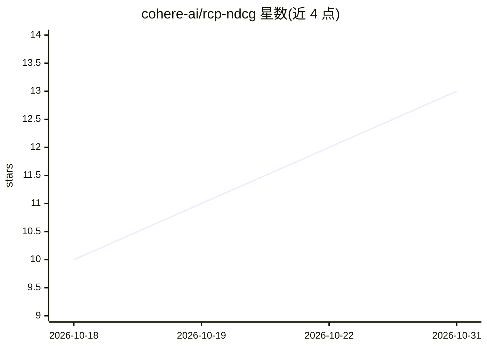

# cohere-ai/rcp-ndcg

⭐ 13 · Python · Apache-2.0 · 推送 2026-10-28 · [GitHub](https://github.com/cohere-ai/rcp-ndcg) · 组织维护

**用 LLM 裁判与 IRT 校准替代人工标注的 nDCG 评测方法**

RCP-nDCG 是一种排序评测指标实现：以校准后的 LLM 裁判取代稀疏人工相关性标注来计算 nDCG 增益。LLM 裁判以列表式锦标赛对每个查询的候选池排序，并对每篇文档回答五条二元评分标准；再由两参数项目反应模型（IRT）将所有查询的锦标赛分数放到同一尺度，文档增益为其通过标准的判别加权概率。仓库含四个发行包：主管线与 CLI、核心指标库、vLLM serving 配方、验证工具。方法见论文，论文表格可从公开数据复现。

## 筛选速览

| 维度 | 判定 | 备注 |
|---|---|---|
| AI 角色 | `ai-ecosystem` | LLM/agent 周边工具 |
| 许可风险 | `permissive` | Apache-2.0 |
| 部署形态 | `library` | 以包/库形式分发 |
| 模型依赖 | local-ok | 支持本地模型 |
| 硬件要求 | — | 无带数字的原话,不猜 |
| 安装摩擦 | `low` | 无编译、无系统依赖或容器化 |
| 成熟度 | — | 结构信号不足 |

## 能力要点

- 列表式锦标赛 LLM 裁判 + 两参数 IRT 模型跨查询校准
- 四个发行包：pipeline/CLI、核心指标、vLLM serving 配方、验证工具
- 论文表格可用 experiments/run_all.py 从公开数据复现

## 适用场景

- 检索系统评测中用 LLM 裁判生成可跨查询比较的 nDCG 分数
- 研究 LLM 裁判判断的校准方法并复现论文结果
- 通过 serving 配方在 GPU 上运行裁判流程

## 场景标签

`模型评测` · 领域:评测与运维

## 证据(README 行号)

> L3: RCP-nDCG is nDCG whose gains come from calibrated LLM judgements instead of sparse human relevance labels. An LLM
> L14: |`rcp-ndcg`|The pipeline and the command line: storage, data, retrieval, judging, calibration, evaluation, runs|rcp
> L15: |`rcp-ndcg-core`|The metric: nDCG, the gains, the scoring protocols, the public records, the IRT estimators (numpy 

## 星数曲线

2026-10-18 10 → 2026-10-31 13（+3）

---
*卡片 v1 · prompt 1.4 · 生成 2026-10-31 · 置信度 high · 依据 README sha `26dd5b3ccac8` · [字段定义](../../DATASET.md)*
