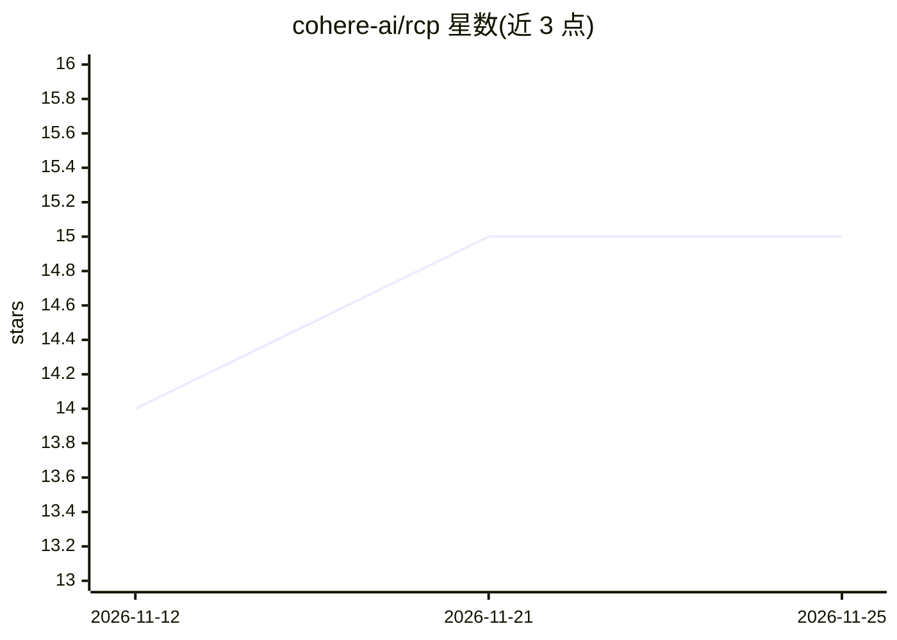

# cohere-ai/rcp

⭐ 15 · Python · Apache-2.0 · 推送 2026-11-17 · [GitHub](https://github.com/cohere-ai/rcp) · 组织维护

**面向科研的 LLM 评判评测指标与流水线：RCP-nDCG**

由 Cohere 维护的评测工具集：RCP-nDCG 是以 LLM 评判提供校准增益的 nDCG 检索评测指标，LLM 评判以 listwise 锦标赛排序候选文档并回答五条二元评分准则，再用二参数项目反应模型（2PL）将各查询的评判分数放到同一尺度。仓库拆分为五个发行包：cohere-rcp（流水线与 CLI）、cohere-rcp-core（指标与 IRT 估计器）、cohere-configkit（配置库）、cohere-rcp-vllm（GPU 验证的 serving 配方）、rcp-test（验证工具，不发布）。pip 安装，附论文、文档站与复现脚本，Apache-2.0 许可。

## 筛选速览

| 维度 | 判定 | 备注 |
|---|---|---|
| AI 角色 | `ai-ecosystem` | LLM/agent 周边工具 |
| 许可风险 | `permissive` | Apache-2.0 |
| 部署形态 | `library` | 以包/库形式分发 |
| 模型依赖 | local-ok | 支持本地模型 |
| 硬件要求 | — | 无带数字的原话,不猜 |
| 安装摩擦 | `low` | 无编译、无系统依赖或容器化 |
| 成熟度 | — | 结构信号不足 |

## 能力要点

- LLM 评判通过 listwise 锦标赛与五条二元准则为 nDCG 提供增益
- 2PL 项目反应模型将跨查询的评判分数校准到同一尺度
- 五个发行包覆盖流水线、指标核心、配置、vLLM serving 与验证工具
- experiments/run_all.py 从公开数据复现论文表格

## 适用场景

- 在缺乏人工相关性标注时评测检索排序质量
- 用本地 vLLM serving 配方运行 LLM 评判流水线
- 复现论文 RCP-nDCG 的实验结果

## 场景标签

`模型评测` `科研工具` · 领域:评测与运维

## 证据(README 行号)

> L3: RCP-nDCG is nDCG (normalized discounted cumulative gain) with calibrated gains. A large language model (LLM) judge
> L8: document is its discrimination-weighted probability of passing the criteria. The paper,
> L9: Rubric-Calibrated Preferences: Cross-Query Calibration of LLM Judgments via Item Response Theory,

## 星数曲线

2026-11-12 14 → 2026-11-25 15（+1）

---
*卡片 v1 · prompt 1.4 · 生成 2026-11-18 · 置信度 high · 依据 README sha `97d25702a92a` · [字段定义](../../DATASET.md)*
