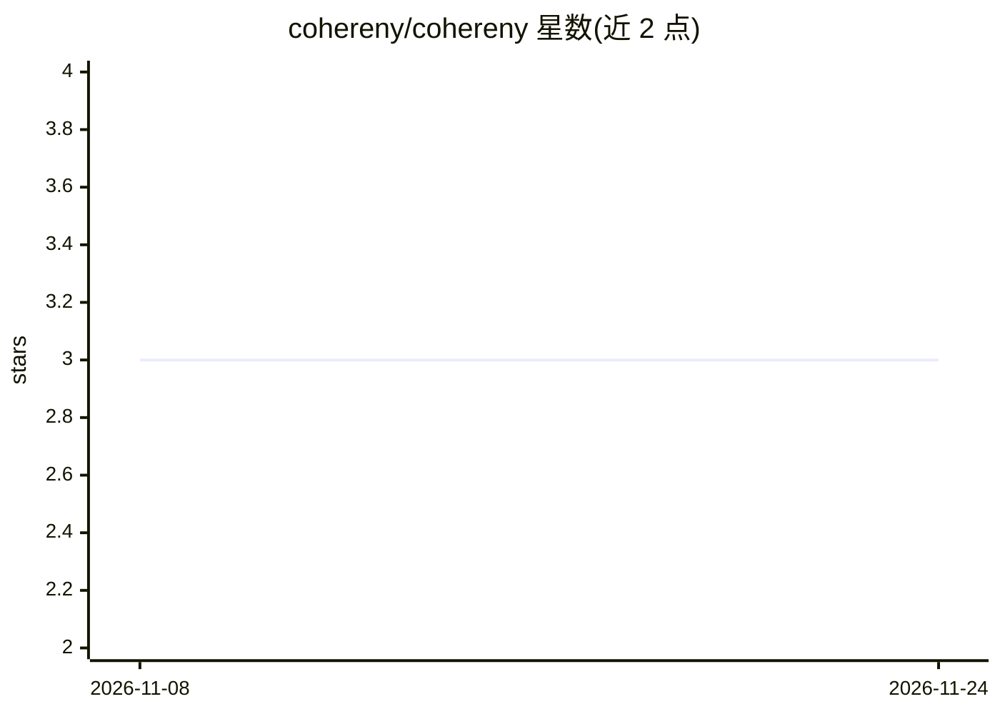

# cohereny/cohereny

⭐ 3 · Python · AGPL-3.0 · 推送 2026-11-13 · [GitHub](https://github.com/cohereny/cohereny) · [官网](https://cohereny.com) · 个人维护

**自托管的多 LLM 工作流上下文中间件：版本化、可评审、按模型路由**

Cohereny 将 system prompt、领域知识、示例、工具 schema 与路由规则从应用代码中抽出，存入团队共享的版本化上下文仓库，经评审与作用域审批后生效；运行时按工作流步骤组合上下文，交给路由规则选定的模型。内置隐私棘轮、四人审批、保留策略、占位符替换、append-only 审计日志与按风险分级的评审门。快速启动需 Docker Compose；自建需 Python 3.12+、PostgreSQL 16+、Redis 7+、OIDC 提供者与 LiteLLM 网关。项目未到 1.0，API 不稳定，两个 LangGraph 试点已弃用。

## 筛选速览

| 维度 | 判定 | 备注 |
|---|---|---|
| AI 角色 | `ai-ecosystem` | LLM/agent 周边工具 |
| 许可风险 | `dual` | AGPL-3.0 |
| 部署形态 | `self-host` | docker 或自建部署 |
| 模型依赖 | local-ok | 支持本地模型 |
| 硬件要求 | — | 无带数字的原话,不猜 |
| 安装摩擦 | `low` | 无编译、无系统依赖或容器化 |
| 成熟度 | `idea` | |

## 能力要点

- 版本化上下文块：评审生命周期、作用域审批与提升机制
- 隐私棘轮：深层作用域只能收紧继承的隐私规则
- 调用前占位符替换（邮箱、电话、IBAN 等），映射按运行加密
- 脱离应用可达的 append-only 审计日志与行级安全可见性控制

## 适用场景

- 多步骤、多模型的工作流中集中管理提示与上下文
- 满足审批与审计要求的 LLM 应用治理
- 模型更新或切换时沉淀每个模型的适配知识供团队复用

## 场景标签

`提示工程` · 领域:Agent 开发

## 证据(README 行号)

> L9: Self-hosted context middleware for multi-LLM workflows: a shared, versioned and
> L52: project or a single person. At runtime Cohereny composes what a workflow step needs and
> L53: hands it to the model the routing rules choose.

## 星数曲线

2026-11-08 3 → 2026-11-24 3（+0）

---
*卡片 v1 · prompt 1.4 · 生成 2026-11-22 · 置信度 high · 依据 README sha `6d08d8be3203` · [字段定义](../../DATASET.md)*
