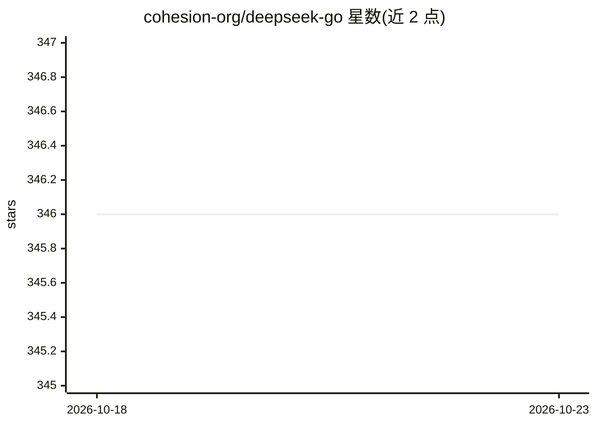

# cohesion-org/deepseek-go

⭐ 346 · Go · MIT · 推送 2026-05-30 · [GitHub](https://github.com/cohesion-org/deepseek-go) · 组织维护

**Go 开发者调用 DeepSeek V4 API 及多家外部推理服务的 SDK**

Go 语言编写的 DeepSeek 平台 API 客户端库：提供类型安全的接口，覆盖流式对话、思维链推理（reasoning_effort 可配）、工具调用（含 beta 严格模式）、FIM 代码补全、结构化 JSON 输出、余额查询与模型列表、中英文 token 估算。除 DeepSeek 官方 API 外，还支持 OpenRouter、Azure、Ollama 及任意 OpenAI 兼容端点（如 vLLM、llama.cpp，可免 API key 连接本地服务），并提供 Anthropic 兼容客户端。Ollama 支持为实验特性。MIT 许可，需 Go 1.26.0 与 API key。

## 筛选速览

| 维度 | 判定 | 备注 |
|---|---|---|
| AI 角色 | `ai-ecosystem` | LLM/agent 周边工具 |
| 许可风险 | `permissive` | MIT |
| 部署形态 | `library` | 以包/库形式分发 |
| 模型依赖 | local-ok | 支持本地模型 |
| 硬件要求 | — | 无带数字的原话,不猜 |
| 安装摩擦 | `low` | 无编译、无系统依赖或容器化 |
| 成熟度 | — | 结构信号不足 |

## 能力要点

- 流式对话、工具调用、FIM 补全、JSON 结构化输出
- 支持 OpenRouter/Azure/Ollama/OpenAI 兼容端点与 Anthropic 兼容客户端
- 可免 API key 校验连接 vLLM/llama.cpp/LocalAI 等本地模型服务
- 客户端中英文 token 估算与多租户 user_id 隔离

## 适用场景

- Go 项目中接入 DeepSeek V4 模型完成对话与代码补全
- 同一套客户端切换 OpenRouter、Azure 或本地推理服务
- 需要结构化 JSON 输出与函数调用的 agent 应用开发

## 场景标签

`模型网关` · 领域:Agent 开发

## 证据(README 行号)

> L12: Deepseek-Go is a Go-based API client for the Deepseek platform. It provides a clean and type-safe interface to inte
> L31: - **External Providers**: OpenRouter, Azure, Ollama, and any OpenAI-compatible endpoint.

## 星数曲线

2026-10-18 346 → 2026-10-23 346（+0）

---
*卡片 v1 · prompt 1.4 · 生成 2026-10-21 · 置信度 high · 依据 README sha `ad02a7c762d3` · [字段定义](../../DATASET.md)*
