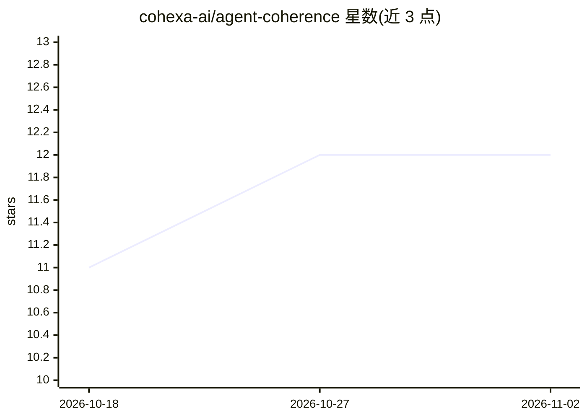

# cohexa-ai/agent-coherence

⭐ 12 · Python · NOASSERTION · 推送 2026-10-26 · [GitHub](https://github.com/cohexa-ai/agent-coherence) · [官网](https://agent-coherence.dev/) · 组织维护

**多智能体共享状态的缓存一致性协调库，防止静默覆盖**

面向单机上共享 plan.md、store key、memory.json 等工件的多智能体系统：以 MESI 风格所有权与失效、乐观提交 CAS、读代际栅栏等机制，把过期写回与并发丢失更新变为类型化的拒绝或可重试冲突，不变式经 TLA+/TLC 模型检查。同一协议覆盖 LangGraph、CrewAI、AutoGen、OpenAI Agents SDK、跨进程文件（CoherentVolume）与 MCP 客户端（stale-write-guard-fs server，mcp extra），不依赖具体模型厂商。附带以约 12-token 失效信号替代全量重播的 token 节省基准。限制：仅覆盖单协调器（单机）、经协调器的写入，跨主机栅栏与外部源自动监听在路线图上未发布。

## 筛选速览

| 维度 | 判定 | 备注 |
|---|---|---|
| AI 角色 | `ai-ecosystem` | LLM/agent 周边工具 |
| 许可风险 | `none` | NOASSERTION |
| 部署形态 | `library` | 以包/库形式分发 |
| 模型依赖 | — | README 未给出锁定关系 |
| 硬件要求 | — | 无带数字的原话,不猜 |
| 安装摩擦 | `low` | 无编译、无系统依赖或容器化 |
| 成熟度 | — | 结构信号不足 |

## 能力要点

- MESI 所有权/失效 + 提交 CAS + 读代际栅栏，过期写拒绝而非静默应用
- 9 条安全不变式经 TLA+/TLC 模型检查，CI 对每个 PR 运行
- LangGraph/CrewAI/AutoGen/OpenAI Agents SDK/MCP/裸文件统一协议
- 写入发布约 12-token 失效信号，读多场景报告 29%-69% token 节省

## 适用场景

- 多 agent 共享计划文件或记忆库时防止丢失更新
- 为 LangGraph store 换入 CCSStore 做读侧缓存失效
- 在 MCP 客户端中接入 stale-write-guard 防止过期写

## 场景标签

`多智能体` `Agent 记忆` · 领域:Agent 开发

## 证据(README 行号)

> L3: **`agent-coherence` stops one agent from silently clobbering another's work on a shared `plan.md`, store key, or `me
> L7: **Why it goes unnoticed.** An agent system keeps two records of what happened: the one your infrastructure can verif
> L18: pip install "agent-coherence[langgraph]"        # LangGraph drop-in

## 星数曲线

2026-10-18 11 → 2026-11-02 12（+1）

---
*卡片 v1 · prompt 1.4 · 生成 2026-11-01 · 置信度 high · 依据 README sha `62f28b35cac8` · [字段定义](../../DATASET.md)*
