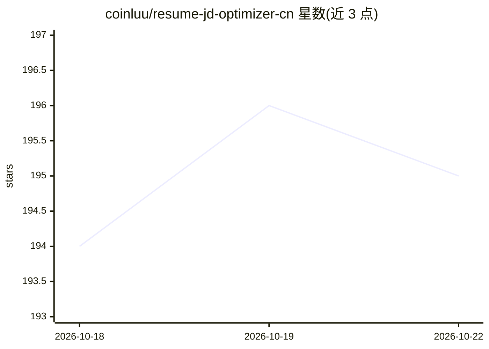

# coinluu/resume-jd-optimizer-cn

⭐ 195 · MIT · 推送 2026-07-21 · [GitHub](https://github.com/coinluu/resume-jd-optimizer-cn) · 个人维护 · 中文 README

**给中国求职者的 JD 驱动中文简历优化 Skill**

以 SKILL.md 规则、10 个阶段 Prompt、评分规则与模板组成的简历优化 Skill，运行在 Codex、ChatGPT Project、自定义 GPT 或自定义 Agent 中。流程为：解析目标 JD（硬性条件/技能/关键词权重）、诊断简历表达问题、建立 JD 与真实经历的证据映射、追问遗漏素材，再生成 JD 定制版简历、ATS 纯文本版、HR 摘要、Boss 直聘开场白与面试追问。设 5 项百分制评分，要求只允许已确认事实进入简历，用户要求造假时停止重写与评分。内置产品、技术、运营、销售、设计等岗位类型参考。

## 筛选速览

| 维度 | 判定 | 备注 |
|---|---|---|
| AI 角色 | `ai-native` | 本体是模型或模型工具 |
| 许可风险 | `permissive` | MIT |
| 部署形态 | `None` |  |
| 模型依赖 | — | README 未给出锁定关系 |
| 硬件要求 | — | 无带数字的原话,不猜 |
| 安装摩擦 | `low` | 无编译、无系统依赖或容器化 |
| 成熟度 | — | 结构信号不足 |

## 能力要点

- JD 解析→证据映射→缺口分析→素材追问→重写→面试追问的 8 步流程
- 5 项百分制评分（JD 匹配/ATS/HR 吸引力/面试准备/可信度），分数须附证据与扣分原因
- 真实性原则：只允许已确认事实进入简历，要求造假时停止输出
- 支持多 JD 独立版本，基于同一事实底稿分别生成

## 适用场景

- 针对某个岗位 JD 定制中文简历并生成 ATS 纯文本版
- 多方向投递时基于同一经历为不同 JD 分别生成版本
- 获取针对数字与个人贡献的面试追问
- AI Agent/Prompt 开发者复用其 Skill、评分规则和测试体系

## 场景标签

`提示工程` · 领域:Agent 开发

## 证据(README 行号)

> L3: ## JD 驱动的中文简历优化 Skill
> L137: |Codex|将完整仓库复制或克隆到 Codex Skills 目录|
> L193: ├── SKILL.md             # 核心规则、输入路由与 8 步流程

## 星数曲线

2026-10-18 194 → 2026-10-22 195（+1）

---
*卡片 v1 · prompt 1.4 · 生成 2026-10-22 · 置信度 high · 依据 README sha `b014264087ab` · [字段定义](../../DATASET.md)*
