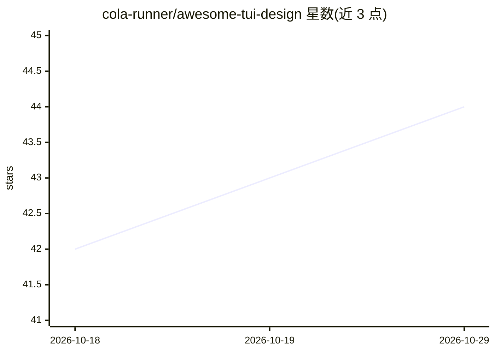

# cola-runner/awesome-tui-design

⭐ 44 · Python · MIT · 推送 2026-04-05 · [GitHub](https://github.com/cola-runner/awesome-tui-design) · 个人维护

**面向 AI 编码 agent 的终端 UI 设计系统清单（DESIGN.md 合集）**

策展型主题清单：从 Claude Code、Codex CLI、Gemini CLI、Lazygit、k9s、btop 等真实 TUI 源码中提炼出 DESIGN.md 设计规范文件，涵盖 AI agent CLI、流行 TUI 应用与 10 套配色方案。使用方式是将 DESIGN.md 放入项目，让 AI agent 按规范构建终端界面；每个色值、Unicode 字符与动画帧均可溯源到源码。无 SDK 与依赖，仅 Markdown；提供模板自建主题与 Python 预览脚本。

## 筛选速览

| 维度 | 判定 | 备注 |
|---|---|---|
| AI 角色 | `ai-knowledge` | 知识聚合/清单类 |
| 许可风险 | `permissive` | MIT |
| 部署形态 | `None` |  |
| 模型依赖 | — | README 未给出锁定关系 |
| 硬件要求 | — | 无带数字的原话,不猜 |
| 安装摩擦 | `low` | 无编译、无系统依赖或容器化 |
| 成熟度 | — | 结构信号不足 |

## 能力要点

- 从真实 TUI 源码提炼 DESIGN.md，细节可溯源
- 覆盖 AI agent CLI、流行 TUI 应用与 10 套配色主题
- 无 SDK 无依赖，AI agent 直接读取 Markdown
- 提供 TEMPLATE.md 自建主题与本地预览脚本

## 适用场景

- 让 AI 编码 agent 按既定设计规范生成终端 UI
- 为 TUI 项目挑选现成的配色与界面风格方案
- 参考主流 TUI 应用的设计细节（边框、动画、色板）

## 场景标签

`精选清单` · 领域:学习与行业

## 证据(README 行号)

> L3:  Curated collection of DESIGN.md files for terminal UI — researched from real TUI source code.
> L12: Drop a `DESIGN.md` into your project, tell your AI agent "build me a terminal UI that looks like this" — and it jus

## 星数曲线

2026-10-18 42 → 2026-10-29 44（+2）

---
*卡片 v1 · prompt 1.4 · 生成 2026-10-25 · 置信度 high · 依据 README sha `f2cd3d3c0df9` · [字段定义](../../DATASET.md)*
