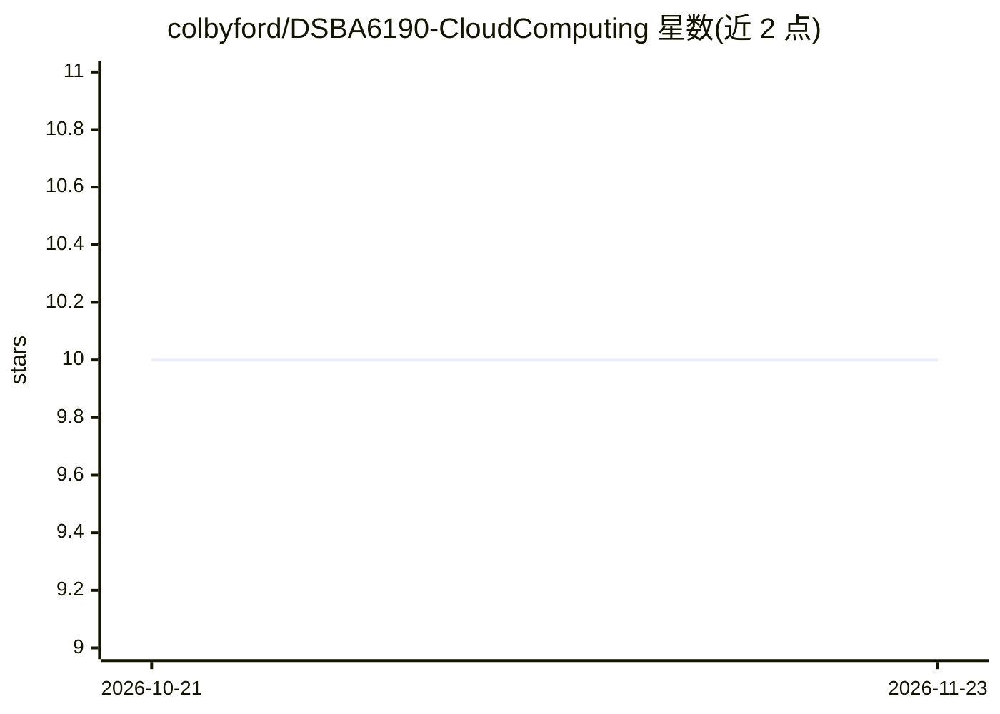

# colbyford/DSBA6190-CloudComputing

⭐ 10 · HTML · GPL-3.0 · 推送 2025-12-16 · [GitHub](https://github.com/colbyford/DSBA6190-CloudComputing) · 个人维护

**DSBA 6190 云计算数据分析课程的教学材料仓库**

北卡罗来纳大学夏洛特分校 DSBA 6190-U90「Cloud Computing for Data Analysis」课程的教学材料集合，由 Colby T. Ford 维护。README 仅声明课程名称、课程号与讲师信息，提供课程资料的组织入口。从主题标签看，内容涉及 Azure 云平台与机器学习相关主题，具体教学文件需在仓库内浏览。未在 README 中给出安装或运行说明。

## 筛选速览

| 维度 | 判定 | 备注 |
|---|---|---|
| AI 角色 | `ai-knowledge` | 知识聚合/清单类 |
| 许可风险 | `viral` | GPL-3.0 |
| 部署形态 | `None` |  |
| 模型依赖 | — | README 未给出锁定关系 |
| 硬件要求 | — | 无带数字的原话,不猜 |
| 安装摩擦 | `low` | 无编译、无系统依赖或容器化 |
| 成熟度 | — | 结构信号不足 |

## 能力要点

- 面向 DSBA 6190-U90 课程的官方教学材料集合
- 主题涉及云计算、Azure 与机器学习
- 由课程讲师 Colby T. Ford, Ph.D. 维护

## 适用场景

- 查阅该课程涉及的云计算与数据分析教学内容
- 了解课程结构与所用云平台主题

## 场景标签

`教程课程` · 领域:学习与行业

## 证据(README 行号)

> L6: Course Materials for the DSBA 6190-U90 - Cloud Computing for Data Analysis Course

## 星数曲线

2026-10-21 10 → 2026-11-23 10（+0）

---
*卡片 v1 · prompt 1.4 · 生成 2026-11-19 · 置信度 mid · 依据 README sha `8b08ca8f5cd7` · [字段定义](../../DATASET.md)*
