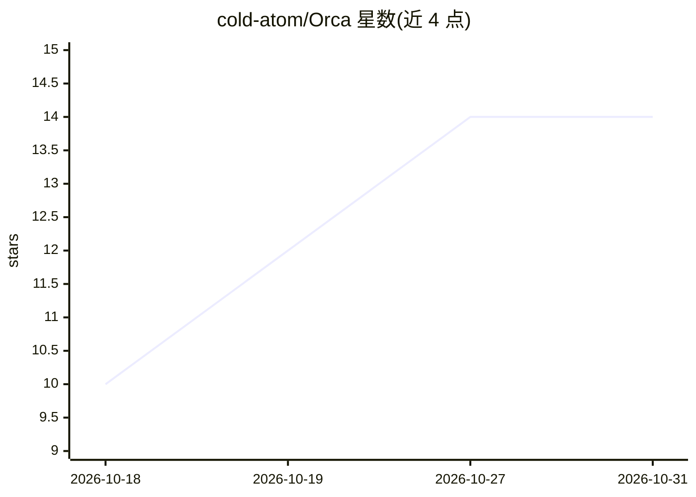

# cold-atom/Orca

⭐ 14 · GDScript · MIT · 推送 2026-10-30 · [GitHub](https://github.com/cold-atom/Orca) · [官网](https://aiorca.dev) · 个人维护

**Godot 编辑器内置的 AI 开发代理：检查项目、审阅后改动**

以 Godot EditorPlugin 形式运行的 MIT 许可 AI 编码代理：在一个原生编辑器 dock 内提供项目探索、场景/脚本/资源感知、Godot 专属工具、变更审阅与受限运行时工作流。连接方式支持 Orca Cloud 账号、自带 provider API key，或经 Ollama、LM Studio 等 OpenAI 兼容端点使用本地模型。核心机制是 Plan（只读）与 Work 模式分离：每次模型请求的文件改动均以 hash 绑定、diff 呈现，等待显式 Apply/Reject，并可回滚；另有 Foundry/Azure Responses 接入、图片附件与脚本引用。限制：图片上限 4 张、脚本快照 300 行/16 KiB；Linux 云登录需 libsecret。

## 筛选速览

| 维度 | 判定 | 备注 |
|---|---|---|
| AI 角色 | `ai-native` | 本体是模型或模型工具 |
| 许可风险 | `permissive` | MIT |
| 部署形态 | `None` |  |
| 模型依赖 | local-ok | 支持本地模型 |
| 硬件要求 | — | 无带数字的原话,不猜 |
| 安装摩擦 | `low` | 无编译、无系统依赖或容器化 |
| 成熟度 | `idea` | |

## 能力要点

- Plan 只读 / Work 审阅写入分离，改动需显式 Apply/Reject 且 hash 绑定可回滚
- 感知 Godot 场景层级、未保存脚本、Input Map、资源依赖等编辑器上下文
- 支持 Ollama / LM Studio 等 OpenAI 兼容本地推理端点
- 图片附件（≤4 张，PNG/JPEG/WebP）与 GDScript 引用拖入上下文

## 适用场景

- 在 Godot 编辑器内让 AI 检查场景与 GDScript 并提出审阅式修改
- 用本地模型（Ollama/LM Studio）做 Godot 项目开发辅助
- 对 AI 提出的 Input Map、主场景、文件改动逐项批准或回滚

## 场景标签

`编码 Agent` · 领域:编码与开发

## 证据(README 行号)

> L26: Orca is an MIT-licensed AI agent built directly into the Godot editor. It combines project exploration, editor awar
> L28: Connect an **Orca Cloud account**, bring your own provider API key, or use a local model through **Ollama**, **LM S
> L54: - **Work mode** can prepare changes and run supported workflows, but every model-requested project change still wai

## 星数曲线

2026-10-18 10 → 2026-10-31 14（+4）

---
*卡片 v1 · prompt 1.4 · 生成 2026-10-31 · 置信度 mid · 依据 README sha `ac7f91b87799` · [字段定义](../../DATASET.md)*
