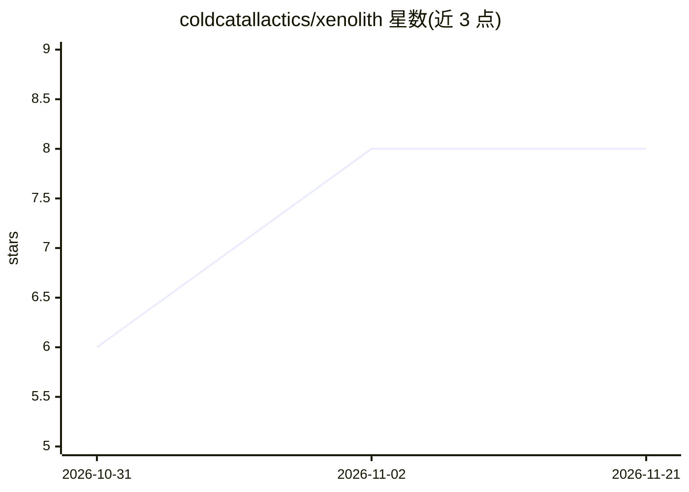

# coldcatallactics/xenolith

⭐ 8 · Common Lisp · ISC · 推送 2026-10-29 · [GitHub](https://github.com/coldcatallactics/xenolith) · 个人维护

**面向 LLM 终端 TUI 的 Autolith 精选配置发行层**

Xenolith 是上游项目 Autolith 的配置层发行版，定位类似 Doom Emacs/Spacemacs 之于 Emacs：不 fork 上游，而是提供外观呈现、默认配置与命令。功能包括 Helix 模态编辑（normal/select/insert/command）、Opencode 风格的 gruvbox 终端界面、可选的上下文预算机制（按上下文填充度而非队列深度约束长任务）。通过 Nix flake、NixOS/Home Manager 模块安装，或依赖上游 autolith 配合 site 配置层从源码运行。ISC 许可。

## 筛选速览

| 维度 | 判定 | 备注 |
|---|---|---|
| AI 角色 | `ai-ecosystem` | LLM/agent 周边工具 |
| 许可风险 | `permissive` | ISC |
| 部署形态 | `None` |  |
| 模型依赖 | — | README 未给出锁定关系 |
| 硬件要求 | — | 无带数字的原话,不猜 |
| 安装摩擦 | `low` | 无编译、无系统依赖或容器化 |
| 成熟度 | — | 结构信号不足 |

## 能力要点

- Helix 模态：composer 中支持 normal/select/insert/command 四种模式
- Opencode 风格 gruvbox 终端界面，含工具块、内联 diff 与状态栏
- 可选的上下文预算机制，按上下文填充度约束子任务
- 提供 Nix flake、NixOS 模块与 Home Manager 模块三种安装方式

## 适用场景

- 在终端中使用 Autolith 时获得统一配置的 TUI 界面
- 在 NixOS 环境中以声明式方式管理 autolith 的站点配置层
- 需要 Helix 风格键位与模态编辑的终端用户

## 场景标签

`精选清单` · 领域:学习与行业

## 证据(README 行号)

> L5: Xenolith is to [[https://github.com/lambda-symbolics/autolith][Autolith]] what Doom Emacs and
> L6: Spacemacs are to Emacs, a curated configuration layer that supplies
> L15: - *Helix modality*: normal, select, insert, and command modes with Helix's word

## 星数曲线

2026-10-31 6 → 2026-11-21 8（+2）

---
*卡片 v1 · prompt 1.4 · 生成 2026-11-20 · 置信度 mid · 依据 README sha `f5e76123bdf1` · [字段定义](../../DATASET.md)*
