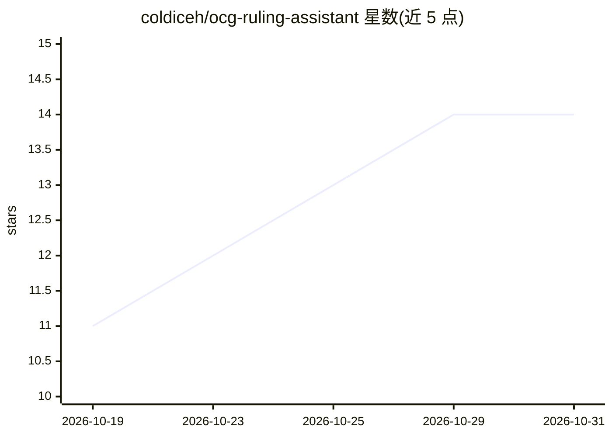

# coldiceh/ocg-ruling-assistant

⭐ 14 · JavaScript · MIT · 推送 2026-10-30 · [GitHub](https://github.com/coldiceh/ocg-ruling-assistant) · [官网](https://coldiceh.github.io/ocg-ruling-assistant/) · 个人维护 · 中文 README

**面向 OCG 玩家的游戏王裁定问答助手（检索+RAG）**

面向所有游戏王 OCG 玩家的 AI 裁定问答助手：用户输入含场面与操作顺序的完整问题后，系统先判断是否与裁定相关、提取并核对卡名与卡片文本，再由辅助模型补充检索线索，从官方卡片数据库 Q&A、FAQ 与规则资料中检索整理依据，最后由用户选定的模型结合原题与依据作答，附引用来源与思考档位。README 明确声明非 KONAMI 官方项目、不替代现场裁判，并以表格给出多模型在 50 题上的正确率与耗时数据。提供在线使用入口，未见本地安装说明。

## 筛选速览

| 维度 | 判定 | 备注 |
|---|---|---|
| AI 角色 | `ai-native` | 本体是模型或模型工具 |
| 许可风险 | `permissive` | MIT |
| 部署形态 | `None` |  |
| 模型依赖 | — | README 未给出锁定关系 |
| 硬件要求 | — | 无带数字的原话,不猜 |
| 安装摩擦 | `low` | 无编译、无系统依赖或容器化 |
| 成熟度 | — | 结构信号不足 |

## 能力要点

- 先检索官方 Q&A/FAQ/规则资料再作答的 RAG 流程，回答附引用来源
- 可识别并核对涉及卡片文本，新卡未收录时可粘贴效果文本分析
- 支持选择模型与思考档位，附多模型正确率/耗时/成本对比表
- 可仅下载整理好的证据，交给其他 AI 自行分析

## 适用场景

- 查询卡片发动、连锁、时点等裁定问题并核对依据
- 店赛或对局中核对裁定，再结合官方资料自行确认
- 下载整理好的官方 Q&A 证据，配合其他工具使用

## 场景标签

`RAG` `文档问答` · 领域:知识与检索

## 证据(README 行号)

> L7: 游戏王 OCG AI裁定面向所有 OCG 玩家，帮助你结合卡片文本、公开规则资料和官方 Q&A 分析裁定问题，并查看回答依据。
> L32: 你可以把它理解为一个先查资料、再分析的裁定助手。收到问题后，它先判断是否与游戏王裁定有关，再提取卡名、核对具体卡片与效果文本。随后保留你的完整原题，让辅助模型补充检索线索，从卡片资料、官方 Q&A、FAQ 和规则资料中查找并整理依

## 星数曲线

2026-10-19 11 → 2026-10-31 14（+3）

---
*卡片 v1 · prompt 1.4 · 生成 2026-10-31 · 置信度 high · 依据 README sha `bef300f556cd` · [字段定义](../../DATASET.md)*
