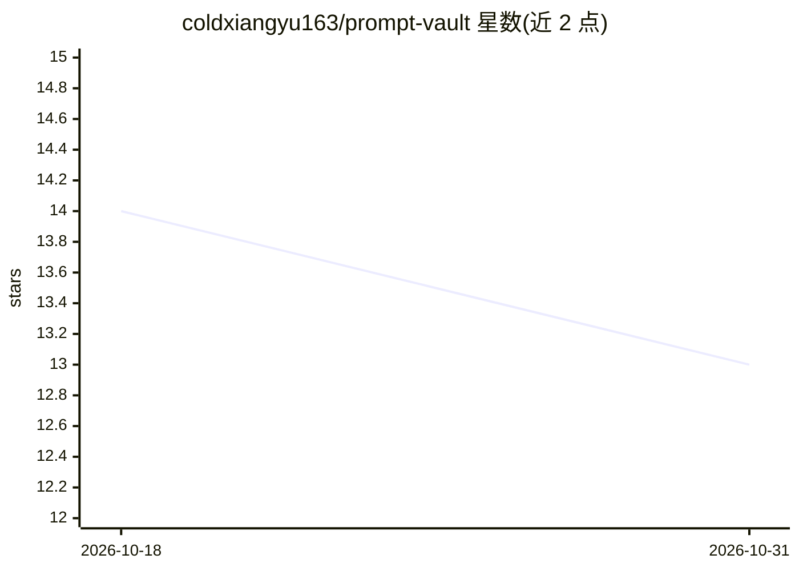

# coldxiangyu163/prompt-vault

⭐ 13 · Python · 推送 2026-04-09 · [GitHub](https://github.com/coldxiangyu163/prompt-vault) · [官网](https://coldxiangyu163.github.io/prompt-vault) · 个人维护 · 中文 README

**AI 生图提示词视觉图库：2500+ 提示词配预览图供搜索复用**

静态网页形式的 AI 图片生成提示词库：收录 2500+ 条采集自 X 平台 AI 生图社区的提示词，每条附带生成效果图与原始推文溯源链接。提供瀑布流浏览、全文搜索（快捷键 /）、按风格与工具标签筛选、一键复制功能，适配桌面与移动端。数据以 prompts.json 格式存储，本地通过 git clone 后启动静态服务运行。条目覆盖 Nano Banana、Midjourney、Flux、DALL-E、Stable Diffusion 等多种工具，提示词版权归原作者，仅供学习参考。

## 筛选速览

| 维度 | 判定 | 备注 |
|---|---|---|
| AI 角色 | `ai-knowledge` | 知识聚合/清单类 |
| 许可风险 | `none` | — |
| 部署形态 | `None` |  |
| 模型依赖 | — | README 未给出锁定关系 |
| 硬件要求 | — | 无带数字的原话,不猜 |
| 安装摩擦 | `low` | 无编译、无系统依赖或容器化 |
| 成熟度 | — | 结构信号不足 |

## 能力要点

- 2500+ 条提示词均附生成效果图
- 全文搜索与风格/工具双维度标签筛选
- 每条提示词附带原始推文溯源链接
- 通过 Issue 模板接受社区提交新提示词

## 适用场景

- 浏览和搜索 AI 生图提示词寻找灵感
- 按工具（Midjourney/Flux 等）筛选可复用的提示词
- 一键复制提示词到生图工具中使用

## 场景标签

`提示工程` `精选清单` · 领域:Agent 开发

## 证据(README 行号)

> L5: > **2500+ AI Prompts** — 收集灵感，一键复用。一个精心策划的 AI 图片生成提示词库，配有预览图和一键复制功能。
> L56: 提示词采集自 X (Twitter) 平台上的 AI 图片生成社区，涵盖多种工具和风格：

## 星数曲线

2026-10-18 14 → 2026-10-31 13（-1）

---
*卡片 v1 · prompt 1.4 · 生成 2026-10-31 · 置信度 high · 依据 README sha `88a8695992f0` · [字段定义](../../DATASET.md)*
