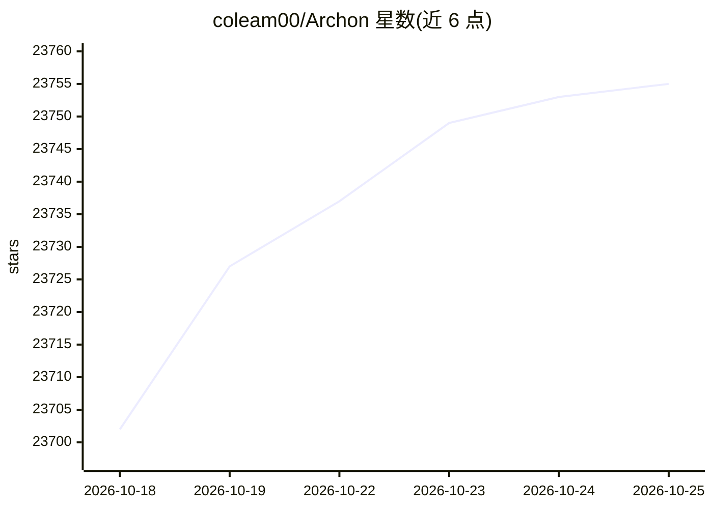

# coleam00/Archon

⭐ 23,755 · TypeScript · MIT · 推送 2026-10-24 · [GitHub](https://github.com/coleam00/Archon) · [官网](https://archon.diy) · 个人维护

**YAML 工作流引擎：编排 AI 编码代理把 issue 变成合并 PR**

自托管的软件工厂构建器：用户以 YAML 描述工作流（代理节点、bash 命令、循环、人工审批门），Archon 用队列与运行器执行。自带 sdlc 包实现 issue 到合并 PR 的流程（intake、构建队列、合并队列、发现记录）。通过 Claude Code、Codex、Pi 自身的 CLI 与 SDK 运行代理，使用用户已有账号。默认 SQLite，可选 PostgreSQL；仓库运行默认独立 git worktree。发送匿名遥测事件，可通过环境变量关闭。安装提供 curl 脚本、PowerShell、Homebrew、源码与 Docker 途径。

## 筛选速览

| 维度 | 判定 | 备注 |
|---|---|---|
| AI 角色 | `ai-ecosystem` | LLM/agent 周边工具 |
| 许可风险 | `permissive` | MIT |
| 部署形态 | `None` |  |
| 模型依赖 | locked-api |  |
| 硬件要求 | — | 无带数字的原话,不猜 |
| 安装摩擦 | `low` | 无编译、无系统依赖或容器化 |
| 成熟度 | — | 结构信号不足 |

## 动量与使用信号

- 维护:`active` — 距上次 push 0.7 天,年发版 26,76 位贡献者
- 涨星:近 1 天 **+9**(自 20261016 起算)
- 下载:GitHub Release 附件 累计 40,858(26 个 release)
- 平台:WINDOWS / MACOS / LINUX / WEB · 协议:MCP

## 能力要点

- YAML 工作流定义节点图：代理判断、脚本计算、人工审批门
- sdlc 包：issue 经计划/实现/审查/CI 到合并 PR
- 通过 CLI/SDK 运行 Claude Code、Codex、Pi，复用已有账号
- 插件体系：workflow pack/provider/forge/chat 四类接缝

## 适用场景

- 把团队的软件开发流程固化为可重复的 AI 代理工作流
- issue 提交后自动完成计划、实现、审查并停在待审批项
- 将内容生产、运营等非编码流程也写成 YAML 工厂

## 场景标签

`工作流自动化` `编码 Agent` · 领域:效率与自动化

## 证据(README 行号)

> L27: - **Your agents, your subscriptions.** Archon is not another coding agent. It runs Claude Code, Codex and Pi throug
> L73: Workflows are not tied to code. A node can be an agent prompt, a bash command, a script, a loop, a wait for a perso
> L82: |Provider|An agent runtime|Claude Code, Codex, Pi|

## 星数曲线

2026-10-18 23,702 → 2026-10-25 23,755（+53）

---
*卡片 v1 · prompt 1.4 · 生成 2026-10-20 · 置信度 high · 依据 README sha `acddafd54907` · [字段定义](../../DATASET.md)*
