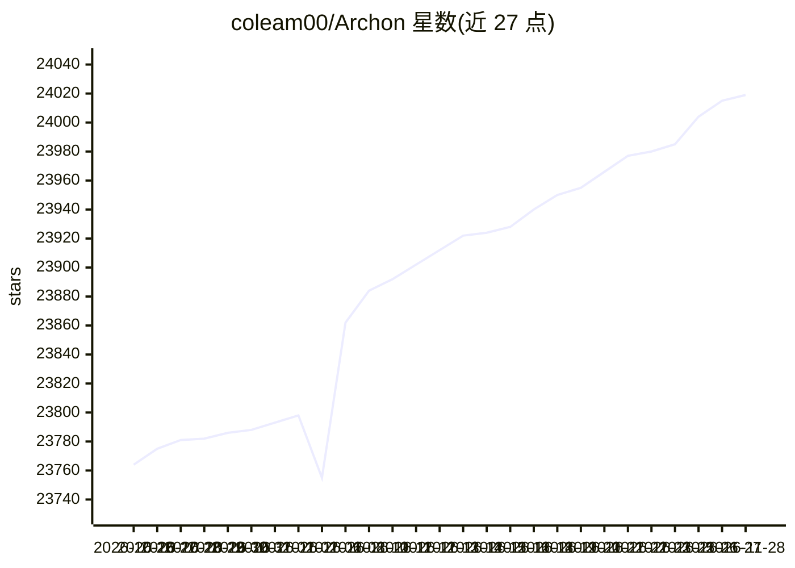

# coleam00/Archon

⭐ 24,019 · TypeScript · MIT · 推送 2026-11-27 · [GitHub](https://github.com/coleam00/Archon) · [官网](https://archon.diy) · 个人维护

**为 AI 编码代理编排 YAML 工作流的开源构建器**

用 YAML 描述工作流程，由工作流引擎调度 AI 代理、脚本与人工决策节点执行；自带 SDLC 工作流包，覆盖从 issue 到合并 PR 的流程，含构建队列、合并队列、审批门、事件日志与每次运行的成本记录。代理通过 Claude Code、Codex、Pi 的 CLI/SDK 运行，账户与订阅沿用用户自有。默认 SQLite 存储，可选 PostgreSQL；提供 CLI、Web 控制台及 Slack/Telegram/Discord/GitHub 接入。MIT 许可，自托管安装，遥测数据匿名且不含消息内容。

## 筛选速览

| 维度 | 判定 | 备注 |
|---|---|---|
| AI 角色 | `ai-ecosystem` | LLM/agent 周边工具 |
| 许可风险 | `permissive` | MIT |
| 部署形态 | `None` |  |
| 模型依赖 | — | README 未给出锁定关系 |
| 硬件要求 | — | 无带数字的原话,不猜 |
| 安装摩擦 | `low` | 无编译、无系统依赖或容器化 |
| 成熟度 | — | 结构信号不足 |

## 动量与使用信号

- 维护:`active` — 距上次 push 0.7 天,年发版 26,76 位贡献者
- 涨星:近 1 天 **+9**(自 20261016 起算)
- 下载:GitHub Release 附件 累计 40,858(26 个 release)
- 平台:WINDOWS / MACOS / LINUX / WEB · 协议:MCP

## 能力要点

- YAML 工作流图：代理节点、命令节点、循环与人工审批节点组合
- 自带 SDLC 包：issue→构建队列→PR→合并队列的完整流程
- 每次运行留存事件日志、完整记录与成本数据
- 通过 forge/chat/provider 等插件契约扩展，GitHub 作插件注册表

## 适用场景

- 让编码代理按固定步骤完成计划、实现、审查到开 PR
- 多个运行并行处理同一仓库的多个任务（git worktree 隔离）
- 把内容生产、研究、运维等非编码流程写成工作流执行

## 场景标签

`工作流自动化` `编码 Agent` · 领域:效率与自动化

## 证据(README 行号)

> L14: Archon is a factory builder. You describe how work should get done as YAML workflows, and Archon runs them with AI 
> L82: |Provider|An agent runtime|Claude Code, Codex, Pi|
> L27: - **Your agents, your subscriptions.** Archon is not another coding agent. It runs Claude Code, Codex and Pi throug

## 星数曲线

2026-10-26 23,764 → 2026-11-28 24,019（+255）

---
*卡片 v1 · prompt 1.4 · 生成 2026-11-22 · 置信度 high · 依据 README sha `d484286da5f3` · [字段定义](../../DATASET.md)*
