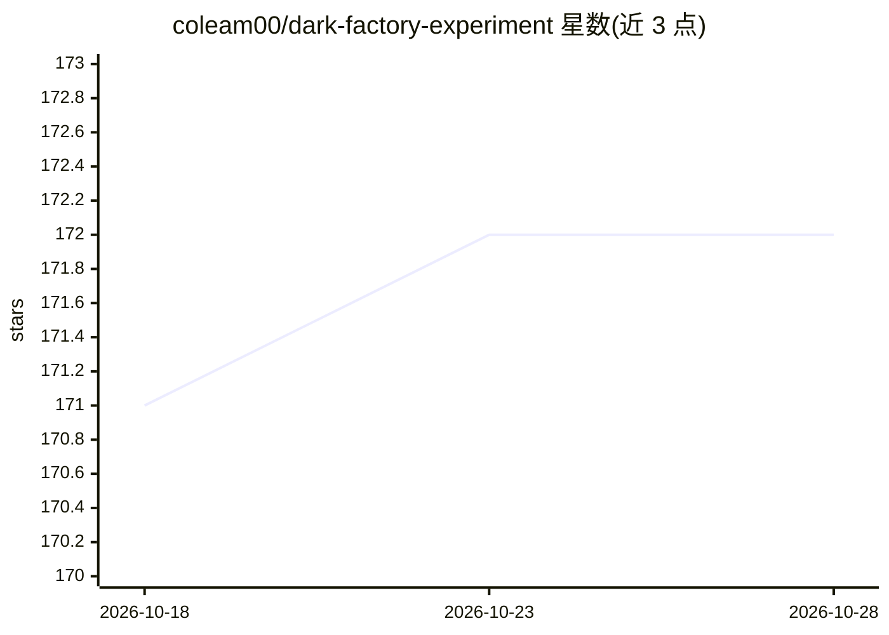

# coleam00/dark-factory-experiment

⭐ 172 · Python · 推送 2026-08-14 · [GitHub](https://github.com/coleam00/dark-factory-experiment) · [官网](https://chat.dynamous.ai) · 个人维护

**AI 自主开发维护的 YouTube RAG 聊天应用与自主工作流实验**

一个公开的 Dark Factory 实验：仓库中的 Web 应用（对创作者 YouTube 视频的带引用 RAG 聊天，React+FastAPI+Postgres/pgvector）其 issue 分诊、实现、代码评审、测试与自动合并几乎全部由 AI 编码代理完成，人类仅提交 issue 和发布版本。工作流引擎为 Archon，节点内由 Claude Code 执行，模型路由为 Claude Sonnet/Haiku（可换为其他模型）。设有人类不可由工厂修改的治理文件与代码边界（auth、限流、部署配置），调度器为纯 bash 定时脚本，以 GitHub 标签作共享状态机。应用层通过 OpenRouter 调用 Claude 生成带引用回答。

## 筛选速览

| 维度 | 判定 | 备注 |
|---|---|---|
| AI 角色 | `ai-ecosystem` | LLM/agent 周边工具 |
| 许可风险 | `none` | — |
| 部署形态 | `None` |  |
| 模型依赖 | locked-api |  |
| 硬件要求 | — | 无带数字的原话,不猜 |
| 安装摩擦 | `low` | 无编译、无系统依赖或容器化 |
| 成熟度 | — | 结构信号不足 |

## 能力要点

- Archon 工作流实现分诊→实现→验证→自动合并的全流程自动化
- 验证器不读实现计划的 holdout 模式与治理文件不可修改规则
- RAG 检索用 tsvector 全文 + pgvector 余弦的 RRF 融合，top-5 片段
- 模型路由按节点配置，可替换（曾运行 MiniMax、Kimi）

## 适用场景

- 参考自主 AI 开发工作流（Dark Factory）的组织方式与治理规则
- 部署一个基于 YouTube 转录文本的带引用 RAG 聊天应用
- 研究混合模型基准测试与 agent 工厂的自愈回归测试闭环

## 场景标签

`编码 Agent` `文档问答` · 领域:编码与开发

## 证据(README 行号)

> L3: **A public Dark Factory experiment.** This repository is a working web application that is built, reviewed, and merg
> L21: 1. **The harness: Archon.** The workflow engine, and the thing that makes the whole experiment possible. Archon let
> L22: 2. **The coding agent: Claude Code.** Inside each AI node, Archon spawns Claude Code as the agent. Claude Code is w

## 星数曲线

2026-10-18 171 → 2026-10-28 172（+1）

---
*卡片 v1 · prompt 1.4 · 生成 2026-10-22 · 置信度 high · 依据 README sha `39c00b1617e9` · [字段定义](../../DATASET.md)*
