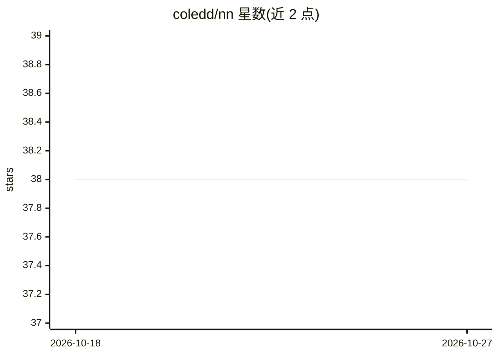

# coledd/nn

⭐ 38 · C++ · Apache-2.0 · 推送 2026-10-13 · [GitHub](https://github.com/coledd/nn) · 组织维护

**面向微控制器与嵌入式系统的轻量级神经网络 C 库**

Apache-2.0 许可的 C 语言神经网络库，核心为可直接嵌入固件的 nn.[ch]，支持 CNN、全连接与 RNN/GRU/LSTM 序列层，另配 FFT、音频 log-mel 特征提取、图像预处理、剪枝、8-bit 量化与模型格式转换等工具。提供 8 个自包含示例（MNIST 字符识别、手势识别、跌倒检测、唤醒词检测、图像分类、血细胞目标检测、预测性维护等），每个示例含 Makefile，预测性维护示例围绕 STM32U585 + IIS3DWB 传感器并支持 make stm32 交叉编译到 Cortex-M33。由 Cole Design and Development, LLC 维护。

## 筛选速览

| 维度 | 判定 | 备注 |
|---|---|---|
| AI 角色 | `ai-native` | 本体是模型或模型工具 |
| 许可风险 | `permissive` | Apache-2.0 |
| 部署形态 | `None` |  |
| 模型依赖 | — | README 未给出锁定关系 |
| 硬件要求 | — | 无带数字的原话,不猜 |
| 安装摩擦 | `low` | 无编译、无系统依赖或容器化 |
| 成熟度 | — | 结构信号不足 |

## 能力要点

- nn.[ch] 可单独拉入嵌入式项目，无需仓库其余部分
- 支持 CNN/全连接/RNN/GRU/LSTM 层类型
- 剪枝与 8-bit 量化工具缩小模型体积
- log-mel 音频特征与 FFT 在实时路径上免内存分配，可入固件

## 适用场景

- 在微控制器上部署训练好的分类/检测模型
- 做唤醒词检测、跌倒检测等边缘 AI 原型
- 用 8-bit 量化与剪枝压缩模型以适配资源受限设备

## 场景标签

`推理引擎` `模型量化` `目标检测` · 领域:感知与多模态

## 证据(README 行号)

> L11: This is a lightweight neural network library for use in microcontrollers and embedded systems.
> L15: 1. `nn.[ch]` - The neural net library, which can be pulled directly into your embedded project. Nothing else in thi

## 星数曲线

2026-10-18 38 → 2026-10-27 38（+0）

---
*卡片 v1 · prompt 1.4 · 生成 2026-10-25 · 置信度 high · 依据 README sha `2a5ca8f1af7f` · [字段定义](../../DATASET.md)*
