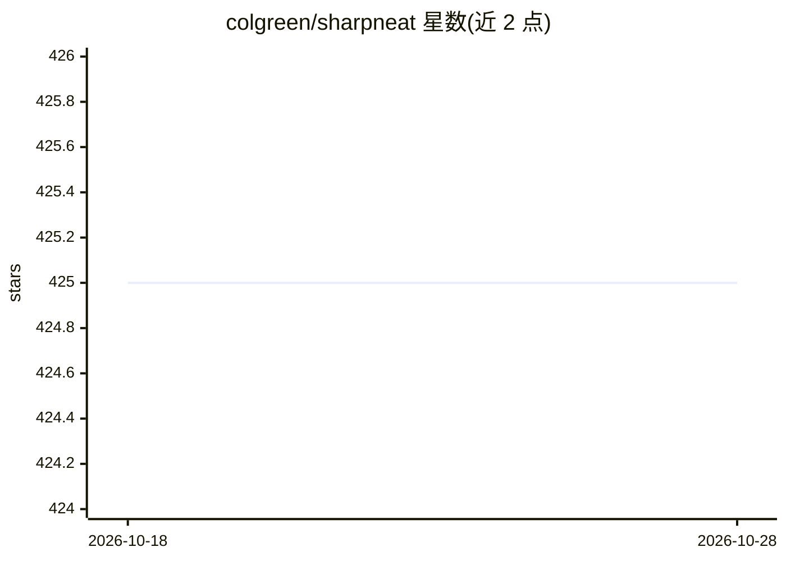

# colgreen/sharpneat

⭐ 425 · C# · NOASSERTION · 推送 2025-11-16 · [GitHub](https://github.com/colgreen/sharpneat) · [官网](https://sharpneat.sourceforge.io/) · 个人维护

**C# 实现的 NEAT 神经网络进化框架，供神经进化研究**

SharpNEAT 是用 C# 编写、面向 .NET 9 的 NEAT（增量拓扑进化算法）完整实现，提供演化神经网络种群以求解问题任务的进化算法框架。通过变异、重组与选择机制搜索在给定任务上表现好的网络，可同时进化网络结构与连接权重，区别于固定结构的反向传播。框架模块化设计，支持替换基因编码或整套进化算法，附带双足/四足行走、火箭垂直飞行、数字逻辑等示例任务，面向进化计算领域的研究与开发。

## 筛选速览

| 维度 | 判定 | 备注 |
|---|---|---|
| AI 角色 | `ai-ecosystem` | LLM/agent 周边工具 |
| 许可风险 | `none` | NOASSERTION |
| 部署形态 | `None` |  |
| 模型依赖 | — | README 未给出锁定关系 |
| 硬件要求 | — | 无带数字的原话,不猜 |
| 安装摩擦 | `medium` | 含编译或系统依赖之一 |
| 成熟度 | — | 结构信号不足 |

## 能力要点

- C# / .NET 9 实现的 NEAT 完整实现
- 同时进化网络结构与连接权重
- 模块化设计，可替换基因编码与进化算法策略
- 附带示例任务（行走控制、火箭悬停、数字逻辑）

## 适用场景

- 用进化算法演化神经网络求解自定义任务
- 研究不同的基因编码或进化算法变体
- 通过示例任务学习组装完整的进化算法

## 场景标签

 · 领域:进化计算/神经进化

## 证据(README 行号)

> L9: SharpNEAT provides an implementation of an Evolutionary Algorithm (EA) that provides the ability to evolve a populat
> L21: SharpNEAT serves as a framework or 'kit of parts' for conducting research in evolutionary computation, particularly

## 星数曲线

2026-10-18 425 → 2026-10-28 425（+0）

---
*卡片 v1 · prompt 1.4 · 生成 2026-10-21 · 置信度 high · 依据 README sha `0df95b697c0c` · [字段定义](../../DATASET.md)*
