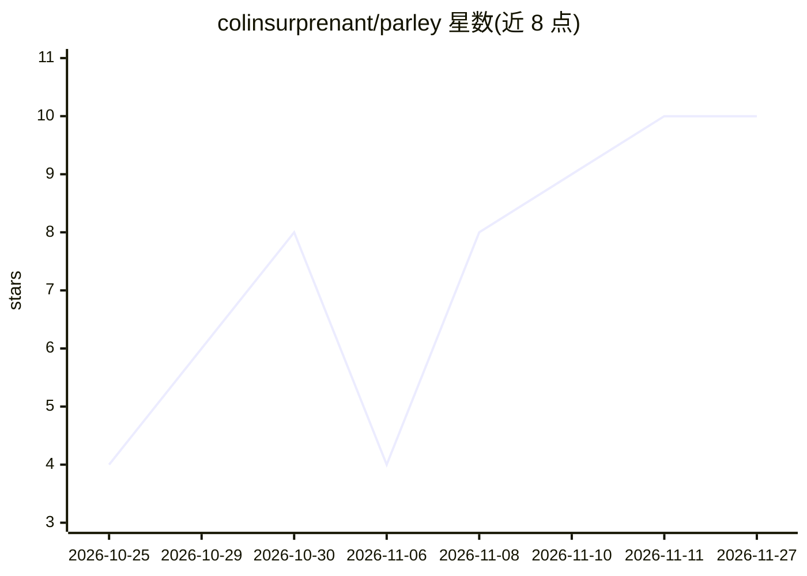

# colinsurprenant/parley

⭐ 10 · Go · Apache-2.0 · 推送 2026-11-26 · [GitHub](https://github.com/colinsurprenant/parley) · 个人维护

**把多个 coding-agent 会话汇入一个 IRC 频道与开发者协作的工具**

以 Go 编写的单一二进制工具，将 Claude Code、Codex CLI、OpenCode 等编码 agent 会话接入本地 IRC 服务器（ergo），使多个会话之间及与用户在同一频道内互相通报变更、请求输入；用户用任意 IRC 客户端查看全部消息并可介入。提供 line（长期并行会话）、table（多席位讨论）、build（双会话分工）三种用法；内置 breaker 规则限制会话循环唤醒，需用户再次发言才继续。所有消息标注为 peer 输入，不代用户权限。

## 筛选速览

| 维度 | 判定 | 备注 |
|---|---|---|
| AI 角色 | `ai-ecosystem` | LLM/agent 周边工具 |
| 许可风险 | `permissive` | Apache-2.0 |
| 部署形态 | `library` | 以包/库形式分发 |
| 模型依赖 | — | README 未给出锁定关系 |
| 硬件要求 | — | 无带数字的原话,不猜 |
| 安装摩擦 | `low` | 无编译、无系统依赖或容器化 |
| 成熟度 | — | 结构信号不足 |

## 能力要点

- 单一 Go 二进制，仅标准库，本地 ergo IRC 服务器承载频道
- 跨 harness 接入：Claude Code 频道、codex queue、OpenCode HTTP API 三种推送路径
- breaker 规则：消息爆发或用户长时间未发言时停止唤醒会话
- line/table/build 三种协作形态，消息以 peer 身份投递

## 适用场景

- 在一个项目中并行运行规划与构建两个 agent 会话并保持同步
- 用 IRC 客户端集中查看并介入所有编码 agent 会话
- 组织多个不同模型的 agent 席位围绕一个问题讨论

## 场景标签

`编码 Agent` `多智能体` · 领域:Agent 开发

## 证据(README 行号)

> L51: - One small Go binary, standard library only.
> L34: Parley works across harnesses: Claude Code and Codex, and OpenCode 2 on a line.

## 星数曲线

2026-10-25 4 → 2026-11-27 10（+6）

---
*卡片 v1 · prompt 1.4 · 生成 2026-11-19 · 置信度 mid · 依据 README sha `598268efed3f` · [字段定义](../../DATASET.md)*
