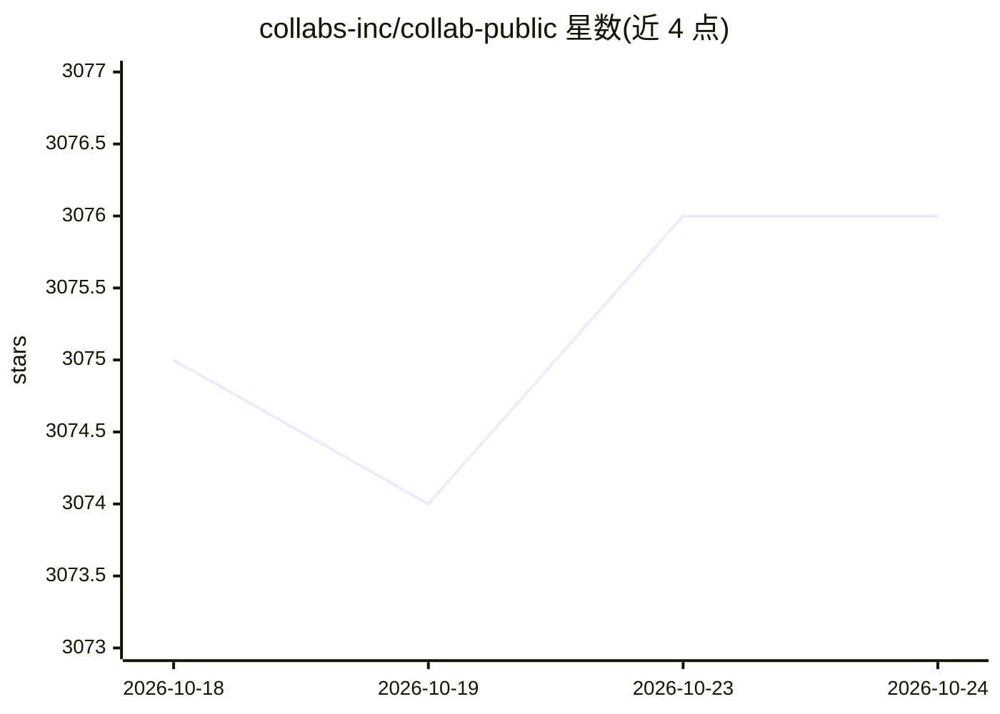

# collabs-inc/collab-public

⭐ 3,076 · TypeScript · NOASSERTION · 推送 2026-08-08 · [GitHub](https://github.com/collabs-inc/collab-public) · [官网](https://collaborator.bot/) · 组织维护

**在无限画布上与 AI agent 并行开发的桌面环境**

面向 macOS/Windows/Linux 的 Electron 原生桌面应用，为 agentic 开发提供端到端环境：在无限缩放画布上布置终端、笔记、代码与图片瓦片；终端由持久 node-pty sidecar 支撑，是运行 AI agent（如 claude-code、codex-cli 类 CLI）的主要界面。支持多工作区、文件树、Monaco 代码编辑、富文本 Markdown 编辑与 D3 力导向图可视化；全部数据以 JSON 存于本地 ~/.collaborator/，无需账号（含 PostHog 匿名分析）。自述处于早期活跃开发阶段。

## 筛选速览

| 维度 | 判定 | 备注 |
|---|---|---|
| AI 角色 | `ai-ecosystem` | LLM/agent 周边工具 |
| 许可风险 | `none` | NOASSERTION |
| 部署形态 | `desktop` | 安装包/桌面程序 |
| 模型依赖 | — | README 未给出锁定关系 |
| 硬件要求 | — | 无带数字的原话,不猜 |
| 安装摩擦 | `low` | 无编译、无系统依赖或容器化 |
| 成熟度 | `idea` | |

## 能力要点

- 无限画布上混合布置终端（PTY）、笔记、代码与图片瓦片
- 终端是运行 AI agent 的主要界面，会话独立持久
- 多工作区与文件树，状态全部本地存储于 ~/.collaborator/
- Electron 40 + React 19 + xterm.js + Monaco 技术栈

## 适用场景

- 在多个终端中同时运行 AI agent CLI 并排查看结果
- 把笔记、代码、图片与运行中的 agent 会话放在同一画布协作
- 以纯本地、无账号方式管理多个项目工作区

## 场景标签

 · 领域:开发者工具/桌面应用

## 证据(README 行号)

> L7: Collaborator is an end-to-end environment for agentic development. Terminals, context files, and running code — all 

## 星数曲线

2026-10-18 3,075 → 2026-10-24 3,076（+1）

---
*卡片 v1 · prompt 1.4 · 生成 2026-10-20 · 置信度 high · 依据 README sha `1b6bf40b9216` · [字段定义](../../DATASET.md)*
