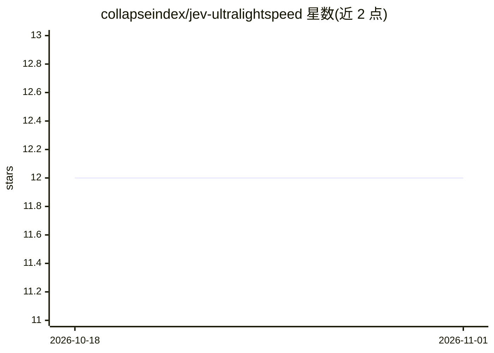

# collapseindex/jev-ultralightspeed

⭐ 12 · Python · NOASSERTION · 推送 2026-09-22 · [GitHub](https://github.com/collapseindex/jev-ultralightspeed) · [官网](https://www.collapseindex.org/) · 个人维护

**把海量文本分类问题打包成少量请求的批处理库**

面向批量判定场景的 Python 库：把多个条目（工单、评论、日志等）打包进单个请求，调用 TypeSafe 的 Jev API 回答关于每条文本的判断性问题（如 triage/classify），从而在按请求数计费/限速的口径下降低请求数量与成本。README 给出 30,000 条判定基准：打包臂与逐条臂准确率一致（89.2%），请求由 30,000 降至 940。附带 demo 脚本、断点续跑（checkpoint）、triage 保留不确定项、位置效应基准与复现脚本；明确不适用于单条等待回复、摘要改写或数千条以下的小批量。

## 筛选速览

| 维度 | 判定 | 备注 |
|---|---|---|
| AI 角色 | `ai-native` | 本体是模型或模型工具 |
| 许可风险 | `none` | NOASSERTION |
| 部署形态 | `library` | 以包/库形式分发 |
| 模型依赖 | — | README 未给出锁定关系 |
| 硬件要求 | — | 无带数字的原话,不猜 |
| 安装摩擦 | `low` | 无编译、无系统依赖或容器化 |
| 成熟度 | — | 结构信号不足 |

## 能力要点

- classify/triage 接口：对一批文本逐条返回类型化判定
- 将 32（最深可测 64）个条目打包进单个请求以降低请求数与成本
- 提供 demo.py、bench/eval.py 等基准与复现脚本
- 回答携带 position 与 packed 字段，可自行核查打包位置效应

## 适用场景

- 批量分诊工单、评论情感分类、日志标记
- 为人工审核前的数据集做预标注，不确定项送人工
- 按新分类标准重跑历史百万行数据（支持断点续跑）

## 场景标签

 · 领域:LLM 应用工具/批处理分类

## 证据(README 行号)

> L17: from jev_ultralightspeed import classify
> L19: answers = classify(tickets, "Does this message need a human to act on it today?")

## 星数曲线

2026-10-18 12 → 2026-11-01 12（+0）

---
*卡片 v1 · prompt 1.4 · 生成 2026-11-01 · 置信度 high · 依据 README sha `08f2f1ae0036` · [字段定义](../../DATASET.md)*
