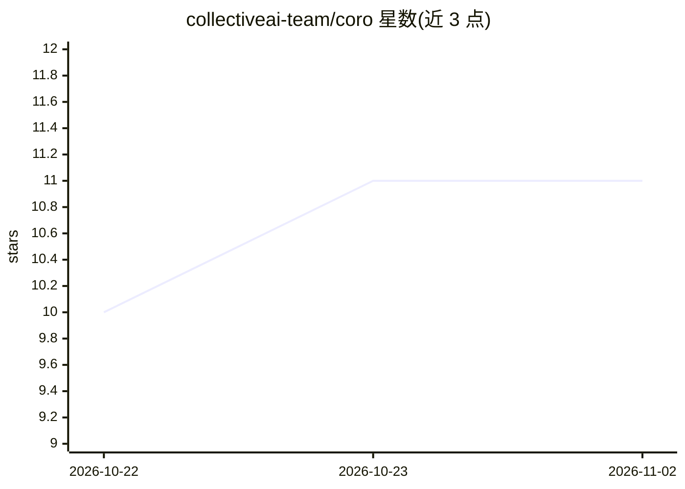

# collectiveai-team/coro

⭐ 11 · Python · MIT · 推送 2026-11-01 · [GitHub](https://github.com/collectiveai-team/coro) · 组织维护

**自托管 ASR + 说话人分离服务器，兼容 OpenAI/Deepgram API**

自托管的语音转文本 HTTP 服务器（FastAPI，Python 3.12），同时实现 OpenAI 与 Deepgram 两套转录 API 契约，官方 openai SDK 或 deepgram-sdk 可直接指向使用，返回带说话人归属的转录结果。ASR 后端可插拔（Canary-1b-v2、Parakeet、Faster-Whisper、Nemotron），分离后端可选 NeMo Sortformer（≤4 说话人）或 pyannote（>4）。支持音视频输入、SSE 与 WebSocket 流式、CPU/GPU、离线命令行转录与窗口缓存。限制：Sortformer 上限 4 说话人；段落级 speaker 标签为时长加权多数而非逐词保证。

## 筛选速览

| 维度 | 判定 | 备注 |
|---|---|---|
| AI 角色 | `ai-native` | 本体是模型或模型工具 |
| 许可风险 | `permissive` | MIT |
| 部署形态 | `self-host` | docker 或自建部署 |
| 模型依赖 | — | README 未给出锁定关系 |
| 硬件要求 | `cpu-ok` | |
| 安装摩擦 | `low` | 无编译、无系统依赖或容器化 |
| 成熟度 | — | 结构信号不足 |

## 能力要点

- 同时实现 OpenAI 与 Deepgram 两套原生 API 契约，CI 按两方 SDK 类型校验响应
- 可插拔 ASR 后端（Canary/Parakeet/Faster-Whisper/Nemotron）与分离后端（NeMo Sortformer/pyannote）
- 流式管道把转录落盘，主机内存占用在数秒到数小时音频上保持平稳
- coro run 离线转录本地文件，ASR 窗口缓存可跳过重复推理（30 分钟音频 392.8s→0.31s）

## 适用场景

- 把已有 OpenAI 或 Deepgram 客户端指向自托管转录服务，无需改代码
- 会议/访谈录音转写并标注谁在什么时候说了什么
- 在本地无服务器环境下离线转录大型录音文件

## 场景标签

`语音识别` · 领域:感知与多模态

## 证据(README 行号)

> L13: Coro is an embedded ASR + speaker-diarization server that speaks **two industry
> L39: - **Pluggable ASR backends, picked by slug** — Canary-1b-v2 INT8/INT8 (the default — forces the request language or
> L44: - **Offline transcription** — `coro run FILE` transcribes a local file with no server and no upload, so a multi-gig

## 星数曲线

2026-10-22 10 → 2026-11-02 11（+1）

---
*卡片 v1 · prompt 1.4 · 生成 2026-11-02 · 置信度 high · 依据 README sha `9b257c0459fd` · [字段定义](../../DATASET.md)*
