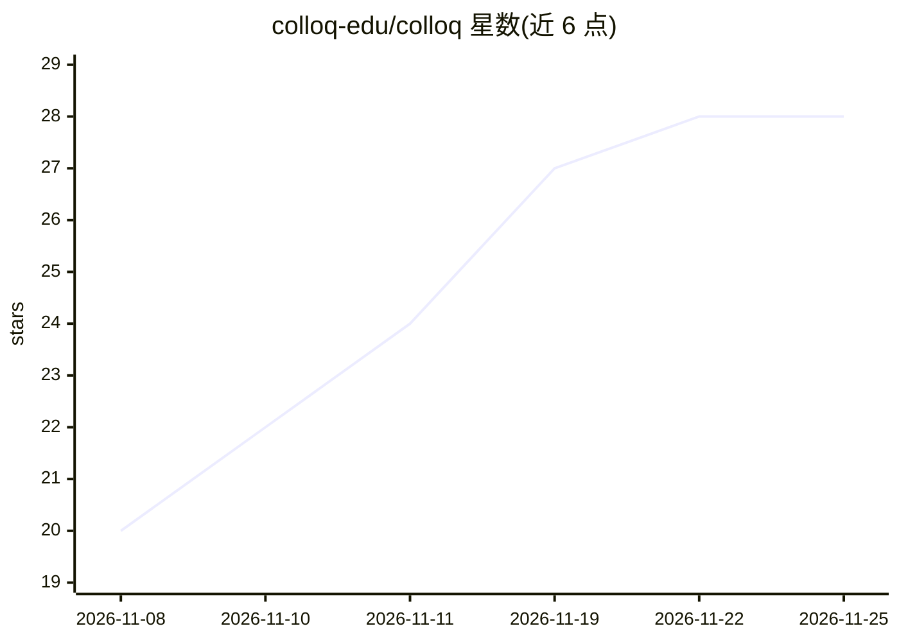

# colloq-edu/colloq

⭐ 28 · TypeScript · MIT · 推送 2026-11-11 · [GitHub](https://github.com/colloq-edu/colloq) · [官网](https://colloq.cc) · 个人维护

**自托管的 Python/数据科学/ML 共享课堂，浏览器一键加入**

面向教师自托管的教学教室：教师创建课程并分享链接，学生仅凭姓名从浏览器进入，共用同一 notebook、文件与 Python 内核，单元格运行结果全班可见。提供 Standard/Lecture/Council 三种预设，权限由服务端强制执行；Council 模式支持每人独立答题、教师批阅与内存/命名空间隔离；讲台控制台支持 iPad 手写 PDF 讲授。内置 Oracle AI 助手可解释代码、提议单元格修改并执行工具操作，支持任意 OpenAI 兼容端点（含 Ollama、vLLM 本地模型），未配置时功能不可用。安装需 pip，运行需 Python 3.9+、Docker（macOS/Linux 或 Windows WSL 2），部分平台需 Node.js 22+。

## 筛选速览

| 维度 | 判定 | 备注 |
|---|---|---|
| AI 角色 | `ai-enhanced` | 去掉 AI 部分产品仍成立 |
| 许可风险 | `permissive` | MIT |
| 部署形态 | `self-host` | docker 或自建部署 |
| 模型依赖 | local-ok | 支持本地模型 |
| 硬件要求 | — | 无带数字的原话,不猜 |
| 安装摩擦 | `low` | 无编译、无系统依赖或容器化 |
| 成熟度 | `idea` | |

## 能力要点

- 学生凭姓名从浏览器加入，共用同一 notebook 与 Python 内核
- Standard/Lecture/Council 三种教学预设，权限由服务端强制执行
- Council 模式：独立答题、批阅展示、命名空间隔离与内存上限保护
- Oracle AI 助手支持任意 OpenAI 兼容端点（含 Ollama/vLLM 本地模型）

## 适用场景

- 教师创建共享 notebook 课堂，学生免安装免账号即可上课
- 课堂中每人独立答题、教师批阅并向全班展示个别答案
- 用 iPad 手写控制台讲授 PDF 并同步到每个学生屏幕
- 在自有服务器或租用 GPU 机器上运行深度学习课程

## 场景标签

 · 领域:教育/编程教学

## 证据(README 行号)

> L9:  A self-hosted classroom for teaching Python, data science and ML together.
> L49: Colloq runs on your own machine or server, under the MIT license. It is built for
> L154: ## An AI the class can follow
> L172: - **Any OpenAI-compatible endpoint and model**, including local models served by

## 星数曲线

2026-11-08 20 → 2026-11-25 28（+8）

---
*卡片 v1 · prompt 1.4 · 生成 2026-11-18 · 置信度 mid · 依据 README sha `43ba6c4dfad5` · [字段定义](../../DATASET.md)*
