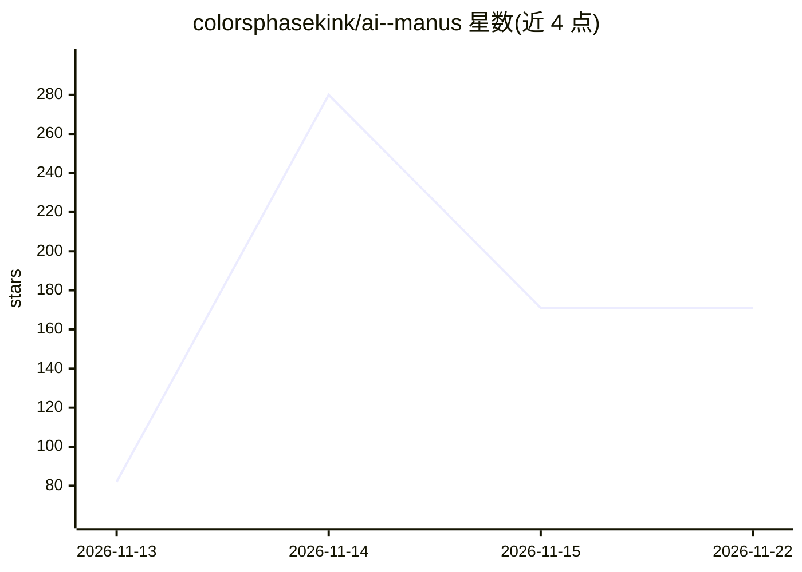

# colorsphasekink/ai--manus

⭐ 171 · Apache-2.0 · 推送 2026-11-15 · [GitHub](https://github.com/colorsphasekink/ai--manus) · 个人维护

**面向日常小任务的自主 AI Agent：自动执行代码与浏览器操作**

README 描述的通用型自主 AI 代理，定位为家庭、学习与轻量办公场景的个人助手：可自主编写并执行脚本、控制浏览器（导航网页、填写表单、采集信息）、执行多步骤任务，并称可跨会话保持任务模式。提供 CPU/内存/存储等兼容性参考表与使用流程说明。README 未给出任何安装命令、依赖说明或源码结构，仅有“Download Manus / PROMO2026”字样，实际获取与运行方式不可验证。

## 筛选速览

| 维度 | 判定 | 备注 |
|---|---|---|
| AI 角色 | `ai-native` | 本体是模型或模型工具 |
| 许可风险 | `permissive` | Apache-2.0 |
| 部署形态 | `None` |  |
| 模型依赖 | — | README 未给出锁定关系 |
| 硬件要求 | — | 无带数字的原话,不猜 |
| 安装摩擦 | `low` | 无编译、无系统依赖或容器化 |
| 成熟度 | — | 结构信号不足 |

## 能力要点

- 自主编写并执行代码完成任务
- 浏览器控制：导航、填表、信息采集
- 脚本与浏览器操作可在同一任务流中衔接
- 定位家庭/学习/轻办公的小规模任务场景

## 适用场景

- 让代理代为执行重复的网页操作与数据收集
- 自动运行小脚本完成计算或文件整理
- 学习与轻度办公中委派多步骤杂务

## 场景标签

`AI 助手` `浏览器自动化` `编码 Agent` · 领域:效率与自动化

## 证据(README 行号)

> L18: Manus is an autonomous AI agent designed to run code and control a browser on your behalf. Instead of acting like a
> L10: - **Autonomous Code Execution:** Manus AI agent runs code on its own to complete tasks, so you can focus on decisio

## 星数曲线

2026-11-13 82 → 2026-11-22 171（+89）

---
*卡片 v1 · prompt 1.4 · 生成 2026-11-17 · 置信度 low · 依据 README sha `0f78ee3a5dd2` · [字段定义](../../DATASET.md)*
