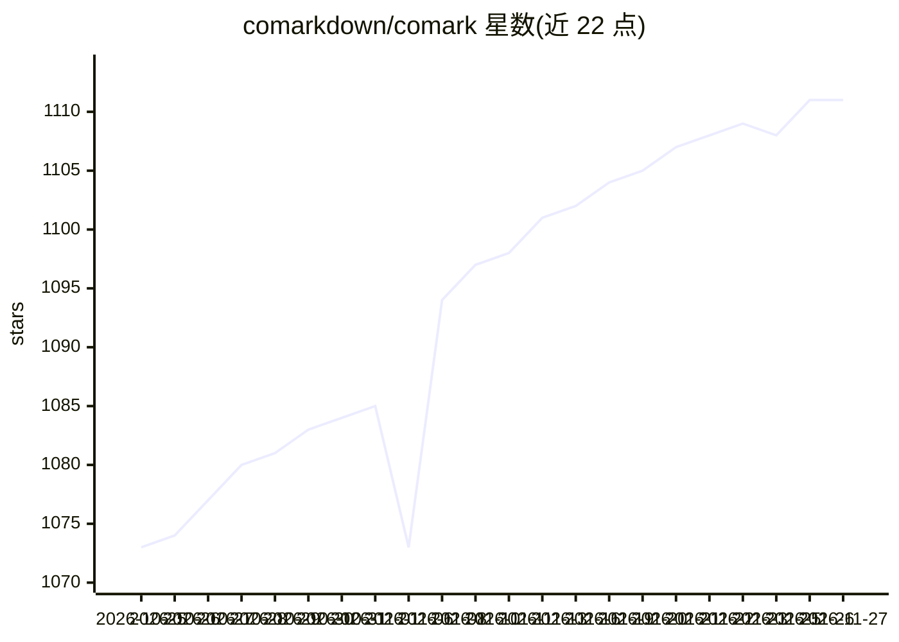

# comarkdown/comark

⭐ 1,111 · TypeScript · MIT · 推送 2026-11-26 · [GitHub](https://github.com/comarkdown/comark) · [官网](https://comark.dev) · 组织维护

**为开发者把 Markdown/LLM 输出解析并渲染到多框架的库**

开源 Markdown 解析与渲染库：将 CommonMark/GFM 解析为可序列化的紧凑文档，支持构建时、运行时与流式三种解析时机；同一文档可渲染到 React、Vue、Svelte、Angular、HTML 与 ANSI 终端。内置流式自动闭合未完成语法（如未闭合的粗体、代码块、组件），提供组件、属性扩展语法与插件生态（Shiki、KaTeX、Mermaid 等），兼容 markdown-it 插件。基于 markdown-exit 构建，TypeScript 编写，以 npm 多包形式发布。

## 筛选速览

| 维度 | 判定 | 备注 |
|---|---|---|
| AI 角色 | `ai-enhanced` | 去掉 AI 部分产品仍成立 |
| 许可风险 | `permissive` | MIT |
| 部署形态 | `library` | 以包/库形式分发 |
| 模型依赖 | — | README 未给出锁定关系 |
| 硬件要求 | — | 无带数字的原话,不猜 |
| 安装摩擦 | `low` | 无编译、无系统依赖或容器化 |
| 成熟度 | — | 结构信号不足 |

## 能力要点

- 流式解析内置自动闭合，未终止语法在每帧均可正确渲染
- 一次解析、多端渲染：HTML、ANSI、Vue、React、Svelte、Angular
- 组件与属性语法（源自 MDC），插件生态含 Shiki/KaTeX/Mermaid/TOC
- 解析与渲染解耦，服务端解析后客户端免重复解析

## 适用场景

- 在聊天界面中流式渲染 LLM 返回的 Markdown 消息
- CMS 或数据库内容无需重建即可实时解析渲染
- 同一份 Markdown 内容跨多个前端框架复用

## 场景标签

 · 领域:前端工具/内容渲染

## 证据(README 行号)

> L12: Comark is an open-source Markdown parser and renderer with components, attributes, and plugins. It streams AI outpu
> L25: - **Runtime parsing**: `parseMarkdown(markdown)` is a pure function returning a compact, serializable Markdown docu
> L26: - **Streaming built in**: auto-close completes unterminated syntax (`**bold`, open code fences, half-open component

## 星数曲线

2026-10-25 1,073 → 2026-11-27 1,111（+38）

---
*卡片 v1 · prompt 1.4 · 生成 2026-11-24 · 置信度 mid · 依据 README sha `f117b49cb742` · [字段定义](../../DATASET.md)*
