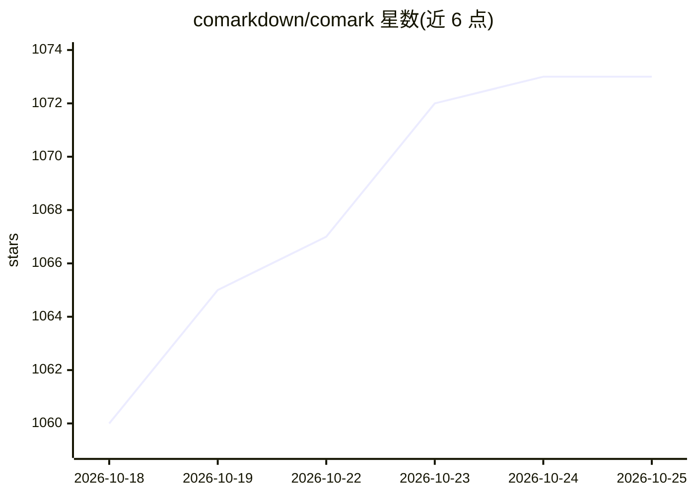

# comarkdown/comark

⭐ 1,074 · TypeScript · MIT · 推送 2026-10-25 · [GitHub](https://github.com/comarkdown/comark) · [官网](https://comark.dev) · 个人维护

**面向 AI 流式输出的 Markdown 解析与多框架渲染库**

开源 Markdown 解析器与渲染器：支持 CommonMark 与 GFM，解析为紧凑可序列化文档，可在构建时、运行时或流式过程中执行；内置 auto-close 机制补全未终止语法，使 AI 输出在流式每一帧均可渲染。同一文档可渲染到 React、Vue、Svelte、Angular、HTML 与终端（ANSI），支持组件、属性语法与插件生态（Shiki、KaTeX、Mermaid、markdown-it 插件兼容）。以 npm 多包形式分发，核心包加各框架渲染器包。组件语法基于 MDC 五年生产使用。

## 筛选速览

| 维度 | 判定 | 备注 |
|---|---|---|
| AI 角色 | `ai-ecosystem` | LLM/agent 周边工具 |
| 许可风险 | `permissive` | MIT |
| 部署形态 | `library` | 以包/库形式分发 |
| 模型依赖 | — | README 未给出锁定关系 |
| 硬件要求 | — | 无带数字的原话,不猜 |
| 安装摩擦 | `low` | 无编译、无系统依赖或容器化 |
| 成熟度 | — | 结构信号不足 |

## 能力要点

- 流式渲染内置：auto-close 补全未终止语法（加粗、代码围栏、半开组件）
- 单一解析器输出到 React/Vue/Svelte/Angular/HTML/ANSI 六种渲染目标
- 解析与渲染解耦：服务端解析一次，客户端免重复解析渲染
- 插件生态：Shiki 高亮、KaTeX 数学、Mermaid 图表，兼容 markdown-it 插件

## 适用场景

- LLM 聊天应用中流式渲染模型输出的 Markdown 与富组件
- 同一份 Markdown 内容跨多个前端框架渲染，避免框架锁定
- 终端（ANSI）场景下渲染 Markdown 内容

## 场景标签

 · 领域:前端/LLM 应用基础设施

## 证据(README 行号)

> L12: Comark is an open-source Markdown parser and renderer with components, attributes and plugins. It streams AI output
> L26: - **Streaming built in**: auto-close completes unterminated syntax (`**bold`, open code fences, half-open component

## 星数曲线

2026-10-18 1,060 → 2026-10-25 1,073（+13）

---
*卡片 v1 · prompt 1.4 · 生成 2026-10-21 · 置信度 high · 依据 README sha `b5c6e4d896eb` · [字段定义](../../DATASET.md)*
