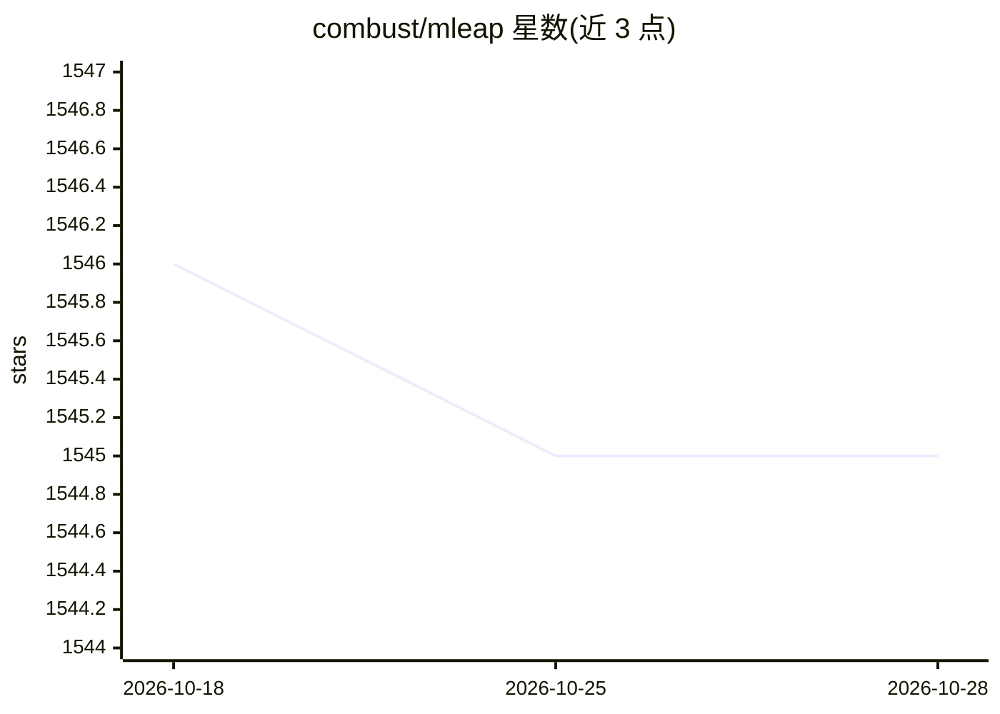

# combust/mleap

⭐ 1,545 · Scala · Apache-2.0 · 推送 2026-10-05 · [GitHub](https://github.com/combust/mleap) · [官网](https://combust.github.io/mleap-docs/) · 组织维护

**把 Spark/Scikit-learn 训练的 ML 管道导出为可移植格式并在 JVM 上离线执行**

面向数据科学家与工程师的机器学习管道部署工具：提供 Bundle.ML 序列化格式（JSON/Protobuf）和 Scala 实现的轻量执行引擎，可将 Spark 或 Scikit-learn 训练的管道导出后在不含 Spark/sklearn/numpy/pandas 依赖的 JVM 环境中运行；支持自定义数据类型与 transformer，并提供 Spark 与 MLeap 管道的对等性测试。通过 Maven/SBT 依赖或 PyPI 安装使用。

## 筛选速览

| 维度 | 判定 | 备注 |
|---|---|---|
| AI 角色 | `ai-ecosystem` | LLM/agent 周边工具 |
| 许可风险 | `permissive` | Apache-2.0 |
| 部署形态 | `self-host` | docker 或自建部署 |
| 模型依赖 | — | README 未给出锁定关系 |
| 硬件要求 | — | 无带数字的原话,不猜 |
| 安装摩擦 | `low` | 无编译、无系统依赖或容器化 |
| 成熟度 | — | 结构信号不足 |

## 能力要点

- Spark / Scikit-learn 管道导出为 Bundle.ML 可移植格式
- 执行时无需依赖 Spark、sklearn、numpy、pandas
- JSON 与 Protobuf 两种序列化格式
- Spark 与 MLeap 管道间的对等性测试

## 适用场景

- 我在 Spark 上训练模型后想脱离 Spark 环境做低开销在线推理
- 把 Scikit-learn 管道导出并在 JVM 服务中执行打分
- 在训练框架与线上运行时之间保持结果一致（对等性测试）

## 场景标签

`推理引擎` · 领域:训练与推理

## 证据(README 行号)

> L17: MLeap provides a performant, portable execution engine and serialization format (Bundle.ML) for machine learning pi
> L22: 2. Export a Spark or Scikit-learn pipeline and run it on the lightweight MLeap Runtime.

## 星数曲线

2026-10-18 1,546 → 2026-10-28 1,545（-1）

---
*卡片 v1 · prompt 1.4 · 生成 2026-10-21 · 置信度 high · 依据 README sha `9f1ef874d136` · [字段定义](../../DATASET.md)*
