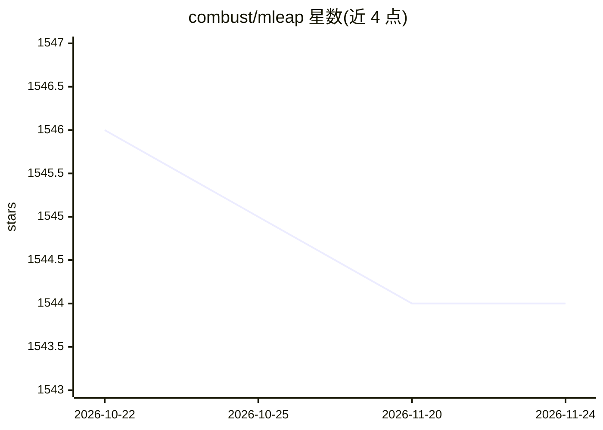

# combust/mleap

⭐ 1,543 · Scala · Apache-2.0 · 推送 2026-11-09 · [GitHub](https://github.com/combust/mleap) · [官网](https://combust.github.io/mleap-docs/) · 组织维护

**面向数据科学与工程团队的 ML 管道生产部署运行时**

提供可移植的机器学习管道执行引擎与序列化格式（Bundle.ML）：用 Spark 或 Scikit-learn 训练管道后导出为 JSON 或 Protobuf 格式，在 JVM 上以轻量 MLeap Runtime 执行，无需依赖 Spark、sklearn、numpy 或 pandas。核心执行引擎以 Scala 实现，支持 Spark、PySpark 与 Scikit-learn，提供 Spark 与 MLeap 管道间的一致性测试，并可通过 Maven、SBT 或 PyPI 集成，开发构建提供 devcontainer/docker 镜像。

## 筛选速览

| 维度 | 判定 | 备注 |
|---|---|---|
| AI 角色 | `ai-ecosystem` | LLM/agent 周边工具 |
| 许可风险 | `permissive` | Apache-2.0 |
| 部署形态 | `self-host` | docker 或自建部署 |
| 模型依赖 | — | README 未给出锁定关系 |
| 硬件要求 | — | 无带数字的原话,不猜 |
| 安装摩擦 | `low` | 无编译、无系统依赖或容器化 |
| 成熟度 | — | 结构信号不足 |

## 能力要点

- Spark/Scikit-learn 管道导出后在 JVM 上脱离 Spark 依赖运行
- 两种可移植序列化格式：JSON 与 Protobuf（Bundle.ML）
- Spark 与 MLeap 管道间全量一致性测试
- 支持自定义 transformer 与数据类型扩展

## 适用场景

- 将 Spark 训练的 ML 管道导出到无 Spark 集群的 JVM 服务中执行
- 把 Scikit-learn 管道序列化为统一格式跨环境部署
- 为管道添加自定义 transformer 并在 Spark 与 MLeap 间复用

## 场景标签

`推理引擎` `MLOps` · 领域:训练与推理

## 证据(README 行号)

> L17: MLeap provides a performant, portable execution engine and serialization format (Bundle.ML) for machine learning pi
> L21: 1. Core execution engine implemented in Scala, with Spark, PySpark, and Scikit-learn support.
> L22: 2. Export a Spark or Scikit-learn pipeline and run it on the lightweight MLeap Runtime.

## 星数曲线

2026-10-22 1,546 → 2026-11-24 1,544（-2）

---
*卡片 v1 · prompt 1.4 · 生成 2026-11-23 · 置信度 high · 依据 README sha `2923abd453ee` · [字段定义](../../DATASET.md)*
