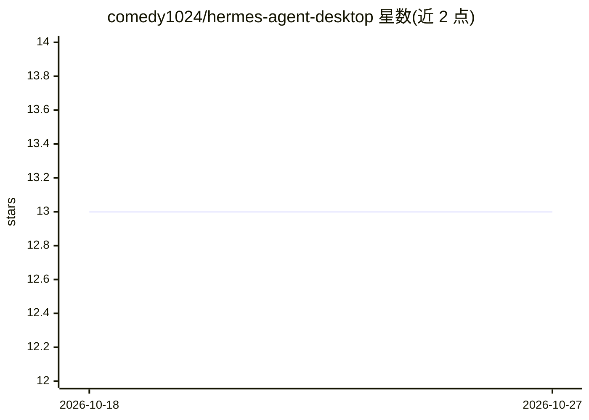

# comedy1024/hermes-agent-desktop

⭐ 13 · HTML · 推送 2026-10-26 · [GitHub](https://github.com/comedy1024/hermes-agent-desktop) · 个人维护 · 中文 README

**将 Hermes Agent 与 WebUI 打包进浏览器可访问的 Linux KDE 桌面 Docker 镜像**

一体化 Docker 镜像：基于 openclaw_computer（Debian 12 + KDE + TigerVNC + noVNC）集成 NousResearch/hermes-agent 与 Hermes WebUI，在浏览器 7860 端口提供完整 Linux 桌面，8648 提供 Web 管理界面，8642 提供 OpenAI 兼容 Gateway API。支持 OpenAI/Anthropic/DeepSeek/Ollama 等十余种 LLM 提供商，配置、记忆与日志持久化于 /root/hermes-data。镜像每日自动检查上游更新，双架构（amd64/arm64）发布，附 ModelScope/HuggingFace Spaces 部署说明；须设置 GATEWAY_ALLOW_ALL_USERS=true 否则 Gateway 拒绝请求。

## 筛选速览

| 维度 | 判定 | 备注 |
|---|---|---|
| AI 角色 | `ai-ecosystem` | LLM/agent 周边工具 |
| 许可风险 | `none` | — |
| 部署形态 | `self-host` | docker 或自建部署 |
| 模型依赖 | local-ok | 支持本地模型 |
| 硬件要求 | — | 无带数字的原话,不猜 |
| 安装摩擦 | `low` | 无编译、无系统依赖或容器化 |
| 成熟度 | — | 结构信号不足 |

## 动量与使用信号

- 安装:github 包 `release-assets` 月下载无数据

## 能力要点

- noVNC 浏览器访问完整 Debian 12 KDE 桌面
- 集成 Hermes Agent、WebUI 与 OpenAI 兼容 Gateway API（三端口）
- 支持 OpenAI/Anthropic/OpenRouter/Gemini/DeepSeek/Ollama/智谱/Kimi 等十余种 LLM 提供商
- 每日定时自动构建，linux/amd64 与 linux/arm64 双架构镜像

## 适用场景

- 在 ModelScope/HuggingFace 等 Cloud Spaces 单端口平台上运行带桌面的 AI Agent
- 通过浏览器远程使用 Linux 桌面环境与 Hermes Agent 聊天/管理界面
- 本地 Docker 一键部署 Hermes Agent 并获得 OpenAI 兼容 API

## 场景标签

`模型网关` · 领域:Agent 开发

## 证据(README 行号)

> L3: 基于 openclaw_computer + NousResearch/hermes-agent + Hermes WebUI 打包的一体化 Docker 镜像。
> L16: - 🤖 **Hermes Agent** — 自演化 AI Agent 框架，支持 OpenAI / Anthropic / DeepSeek / Ollama 等
> L243:   ├─ Hermes Gateway (:8642) → 后台进程，自动重启

## 星数曲线

2026-10-18 13 → 2026-10-27 13（+0）

---
*卡片 v1 · prompt 1.4 · 生成 2026-10-18 · 置信度 high · 依据 README sha `7e459a8f904c` · [字段定义](../../DATASET.md)*
