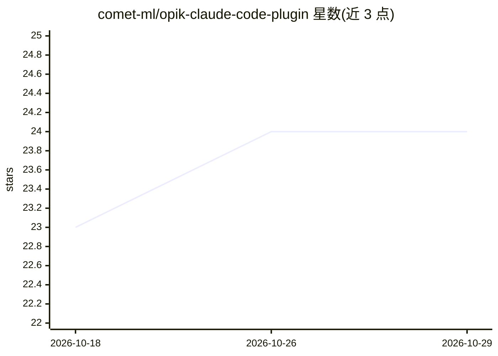

# comet-ml/opik-claude-code-plugin

⭐ 24 · Go · Apache-2.0 · 推送 2026-10-22 · [GitHub](https://github.com/comet-ml/opik-claude-code-plugin) · [官网](https://www.comet.com/site/products/opik/) · 组织维护

**把 Claude Code 会话记录为 Opik 追踪的插件**

由 Comet（Opik 团队）维护的 Claude Code 插件：将每个对话轮次记录为 Opik trace，工具调用、思考与响应作为 span，子 agent 调用按父子关系嵌套。提供 Opik MCP server 供 Claude 在对话中查询追踪与评测结果；/opik:instrument 命令可自动检测代码中的框架（OpenAI、LangChain、Bedrock 等）并添加 Opik 埋点；附带 11 个 Opik 技能、代码审查 agent。通过 Claude Code 插件市场安装，配置依赖 pip 安装的 opik CLI。

## 筛选速览

| 维度 | 判定 | 备注 |
|---|---|---|
| AI 角色 | `ai-ecosystem` | LLM/agent 周边工具 |
| 许可风险 | `permissive` | Apache-2.0 |
| 部署形态 | `library` | 以包/库形式分发 |
| 模型依赖 | — | README 未给出锁定关系 |
| 硬件要求 | — | 无带数字的原话,不猜 |
| 安装摩擦 | `low` | 无编译、无系统依赖或容器化 |
| 成熟度 | — | 结构信号不足 |

## 能力要点

- 会话级 trace/span 记录，子 agent 父子嵌套
- MCP server 使 Claude 可查询 Opik 追踪与实验数据
- /opik:instrument 自动检测框架并添加埋点（Python/TypeScript）
- 内置 11 个 Opik 技能与 agent-reviewer 代码审查 agent

## 适用场景

- 在 Claude Code 中自动记录会话到 Opik 做可观测性分析
- 让 Claude 在对话中直接查询 Opik 追踪与评测结果
- 给自己的 agent 代码自动加上 Opik 追踪埋点

## 场景标签

`LLM 可观测性` `代码审查` · 领域:编码与开发

## 证据(README 行号)

> L3: Log Claude Code sessions to Opik for LLM observability, plus skills and agents for building observable AI applicatio
> L9: - **Session Tracing**: Automatically log Claude Code sessions as Opik traces
> L95: The Opik MCP server provides Claude with tools to interact with your Opik data - query traces, analyze experiments,

## 星数曲线

2026-10-18 23 → 2026-10-29 24（+1）

---
*卡片 v1 · prompt 1.4 · 生成 2026-10-27 · 置信度 mid · 依据 README sha `63fcff7add57` · [字段定义](../../DATASET.md)*
