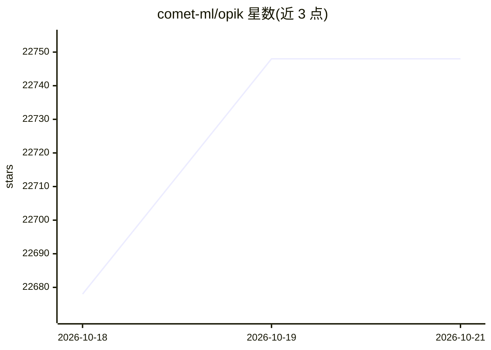

# comet-ml/opik

⭐ 22,748 · Python · Apache-2.0 · 推送 2026-10-19 · [GitHub](https://github.com/comet-ml/opik) · [官网](https://www.comet.com/docs/opik/) · 组织维护 · 中文 README

**面向 LLM 应用团队的观测、评估与 Agent 追踪平台**

由 Comet 开发的开源 LLM 可观测性与评估平台，Apache-2.0 授权，包含服务端后端与 Web 应用，可完整自托管。核心能力：多步 Agent 与工具调用的追踪树、基于数据集与实验的 LLM 评估（含 LLM-as-a-judge 指标如幻觉检测）、Prompt 管理与 Playground、生产仪表盘与在线评估规则、PyTest CI/CD 集成，自述设计规模为每日 4000 万条以上 trace。提供 Python/TypeScript SDK、REST API 与 OpenTelemetry 支持，另可通过 MCP 命令接入 Claude Code、Cursor 等编码代理。

## 筛选速览

| 维度 | 判定 | 备注 |
|---|---|---|
| AI 角色 | `ai-ecosystem` | LLM/agent 周边工具 |
| 许可风险 | `permissive` | Apache-2.0 |
| 部署形态 | `self-host` | docker 或自建部署 |
| 模型依赖 | — | README 未给出锁定关系 |
| 硬件要求 | — | 无带数字的原话,不猜 |
| 安装摩擦 | `low` | 无编译、无系统依赖或容器化 |
| 成熟度 | — | 结构信号不足 |

## 动量与使用信号

- 维护:`active` — 距上次 push 1.0 天,年发版 93,165 位贡献者
- 涨星:近 1 天 **+35**(自 20261016 起算)
- 安装:pypi 包 `opik` 月下载 1,741,711
- 平台:— · 协议:MCP / OLLAMA

## 能力要点

- AI Agent 追踪：多步 trace 树覆盖 LLM 调用、工具执行与检索步骤
- LLM 评估：数据集、实验与 LLM-as-a-judge 指标（幻觉检测、审核、RAG 评估）
- Apache-2.0 完整平台可自托管，支持 Docker Compose 与 Kubernetes/Helm
- MCP 命令接入 Claude Code、Cursor、VS Code Copilot 等编码代理

## 适用场景

- 为生产环境的 Agent 工作流记录和分析多步调用链路
- 用数据集和 LLM-as-a-judge 指标自动化评估 RAG 应用质量
- 在内网自托管部署，让 trace 数据不出自有基础设施
- 在 CI/CD 中对 LLM 流水线做每次提交的回归测试

## 场景标签

`LLM 可观测性` `模型评测` `提示工程` · 领域:Agent 开发

## 证据(README 行号)

> L10:  Opik is the open-source LLM observability and evaluation platform for AI agent tracing, LLM evaluation, prompt man
> L33: - **AI Agent Tracing & Observability**: Deep tracing of LLM calls, conversation logging, and agent activity, with f
> L190: Opik provides a suite of client libraries and a REST API to interact with the Opik server. This includes SDKs for 

## 星数曲线

2026-10-18 22,678 → 2026-10-21 22,748（+70）

---
*卡片 v1 · prompt 1.4 · 生成 2026-10-18 · 置信度 mid · 依据 README sha `a8bf7d11ec2e` · [字段定义](../../DATASET.md)*
