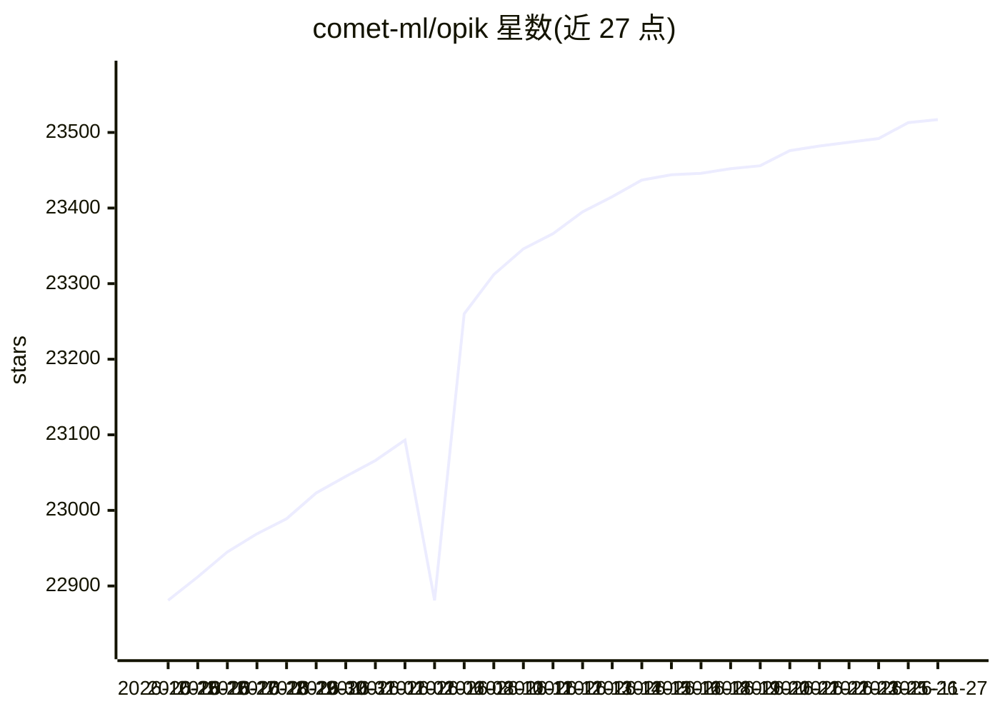

# comet-ml/opik

⭐ 23,517 · Java · Apache-2.0 · 推送 2026-11-26 · [GitHub](https://github.com/comet-ml/opik) · [官网](https://www.comet.com/docs/opik/) · 组织维护

**开源 LLM 应用可观测与评测平台：追踪、评估、监控**

由 Comet 开发的开源 LLM 可观测与评测平台（Apache-2.0），覆盖 AI agent 追踪、LLM 评估、prompt 管理与生产监控。机制上通过 Python/TypeScript SDK 与 @track 装饰器记录嵌套调用链，支持 LLM-as-a-judge 指标（幻觉检测、审核、RAG 评估）、数据集与实验、PyTest CI/CD 集成及在线评估规则。提供云托管与自托管两种部署，自托管支持 Docker Compose 与 Kubernetes/Helm；通过 OpenTelemetry 可从 Java、Ruby、.NET 等语言发送追踪。面向构建 LLM 应用与 agent 的工程团队。

## 筛选速览

| 维度 | 判定 | 备注 |
|---|---|---|
| AI 角色 | `ai-ecosystem` | LLM/agent 周边工具 |
| 许可风险 | `permissive` | Apache-2.0 |
| 部署形态 | `self-host` | docker 或自建部署 |
| 模型依赖 | local-ok | 支持本地模型 |
| 硬件要求 | — | 无带数字的原话,不猜 |
| 安装摩擦 | `low` | 无编译、无系统依赖或容器化 |
| 成熟度 | — | 结构信号不足 |

## 动量与使用信号

- 维护:`active` — 距上次 push 1.0 天,年发版 93,165 位贡献者
- 涨星:近 1 天 **+35**(自 20261016 起算)
- 安装:pypi 包 `opik` 月下载 1,741,711
- 平台:— · 协议:MCP / OLLAMA

## 能力要点

- 多步 agent 追踪：LLM 调用、工具执行、检索步骤的完整追踪树
- LLM-as-a-judge 评估指标：幻觉检测、审核、RAG 评估（答案相关性、上下文精度）
- 自托管完整平台含服务端与 Web 应用，Apache-2.0 许可
- 集成列表覆盖大量框架与 provider，含 PyTest CI/CD 评估与 MCP 服务器

## 适用场景

- 跟踪调试多步 agent 工作流与 RAG 系统的调用链
- 用数据集与 LLM-as-a-judge 自动评估 prompt 变更效果
- 在企业自有基础设施内自托管监控生产 LLM 调用
- 在 CI/CD 流水线中每次提交时测试 LLM pipeline

## 场景标签

`LLM 可观测性` `模型评测` · 领域:评测与运维

## 证据(README 行号)

> L10:  Opik is the open-source LLM observability and evaluation platform for AI agent tracing, LLM evaluation, prompt man
> L33: - **AI Agent Tracing & Observability**: Deep tracing of LLM calls, conversation logging, and agent activity, with f
> L34: - **LLM Evaluation**: Datasets, experiments, and LLM-as-a-judge metrics for hallucination detection, moderation, an

## 星数曲线

2026-10-25 22,881 → 2026-11-27 23,517（+636）

---
*卡片 v1 · prompt 1.4 · 生成 2026-11-27 · 置信度 mid · 依据 README sha `24f29c1eefe5` · [字段定义](../../DATASET.md)*
