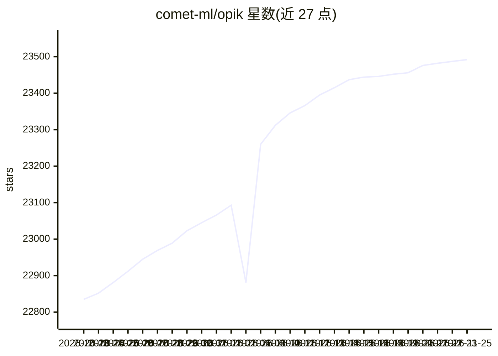

# comet-ml/opik

⭐ 23,492 · Java · Apache-2.0 · 推送 2026-11-24 · [GitHub](https://github.com/comet-ml/opik) · [官网](https://www.comet.com/docs/opik/) · 组织维护 · 中文 README

**开源 LLM 可观测性与评测平台：追踪、评估、监控 LLM 应用**

由 Comet 开发、Apache-2.0 许可的 LLM 可观测性与评测平台，覆盖从开发期 trace 到生产监控的完整链路。核心机制包括：通过 @track 装饰器或框架集成记录多步 agent 与 LLM 调用的 trace 树；用数据集与实验做自动化评测，含 LLM-as-a-judge 指标（幻觉检测、审核、RAG 评估）；提供 Prompt Playground、Agent Optimizer、Guardrails 与在线评测规则；支持 PyTest 集成进入 CI/CD。平台整体可自托管（含后端与 Web 界面），SDK 覆盖 Python/TypeScript，并支持 OpenTelemetry 协议接入。

## 筛选速览

| 维度 | 判定 | 备注 |
|---|---|---|
| AI 角色 | `ai-ecosystem` | LLM/agent 周边工具 |
| 许可风险 | `permissive` | Apache-2.0 |
| 部署形态 | `self-host` | docker 或自建部署 |
| 模型依赖 | local-ok | 支持本地模型 |
| 硬件要求 | — | 无带数字的原话,不猜 |
| 安装摩擦 | `low` | 无编译、无系统依赖或容器化 |
| 成熟度 | — | 结构信号不足 |

## 动量与使用信号

- 维护:`active` — 距上次 push 1.0 天,年发版 93,165 位贡献者
- 涨星:近 1 天 **+35**(自 20261016 起算)
- 安装:pypi 包 `opik` 月下载 1,741,711
- 平台:— · 协议:MCP / OLLAMA

## 能力要点

- 多步 agent trace 树记录，含 LLM 调用、工具执行与检索步骤
- LLM-as-a-judge 评测：幻觉检测、审核、RAG 评估指标
- 全平台（含服务端）Apache-2.0 可自托管，支持 Docker/Kubernetes/Helm
- 提供 MCP 服务器，可从 Claude Code、Cursor 等编码 agent 读取 trace 并运行评测

## 适用场景

- 追踪与调试多步 agent 工作流与 RAG 系统的调用链
- 上线前用数据集与 LLM-as-a-judge 自动评测应用质量
- 在自有基础设施自托管监控生产环境的 trace 与 token 用量
- 将 LLM 流水线测试集成到每次提交的 CI/CD 中

## 场景标签

`LLM 可观测性` `模型评测` `提示工程` · 领域:Agent 开发

## 证据(README 行号)

> L10:  Opik is the open-source LLM observability and evaluation platform for AI agent tracing, LLM evaluation, prompt man
> L33: - **AI Agent Tracing & Observability**: Deep tracing of LLM calls, conversation logging, and agent activity, with f
> L34: - **LLM Evaluation**: Datasets, experiments, and LLM-as-a-judge metrics for hallucination detection, moderation, an

## 星数曲线

2026-10-23 22,835 → 2026-11-25 23,492（+657）

---
*卡片 v1 · prompt 1.4 · 生成 2026-11-24 · 置信度 mid · 依据 README sha `2cb6c779483e` · [字段定义](../../DATASET.md)*
