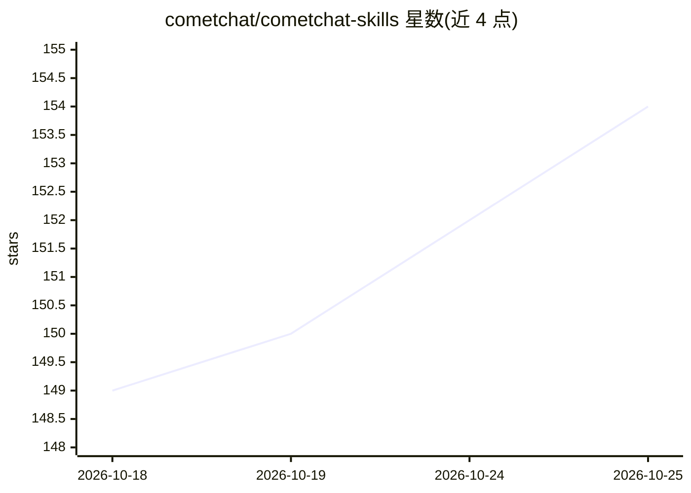

# cometchat/cometchat-skills

⭐ 154 · JavaScript · MIT · 推送 2026-10-15 · [GitHub](https://github.com/cometchat/cometchat-skills) · [官网](https://www.cometchat.com) · 组织维护

**让 AI 编程助手为应用接入 CometChat 聊天与音视频通话的技能包**

CometChat 官方发布的 agent skills 包（npm 包 @cometchat/skills v5）：通过 npx 安装器自动检测项目框架，为 Claude Code、Cursor、Codex 等 50 余种 AI 编程助手安装技能；随后开发者用自然语言指示 agent 编写生产级集成代码。覆盖六个 UI Kit（React/Angular/React Native/iOS/Android/Flutter）及 headless Calls/Chat SDK 技能，另含从 Sendbird、Stream 迁移的技能，并附带 MCP 文档插件与获取凭据的 dashboard CLI。MIT 许可。

## 筛选速览

| 维度 | 判定 | 备注 |
|---|---|---|
| AI 角色 | `ai-ecosystem` | LLM/agent 周边工具 |
| 许可风险 | `permissive` | MIT |
| 部署形态 | `library` | 以包/库形式分发 |
| 模型依赖 | locked-api |  |
| 硬件要求 | — | 无带数字的原话,不猜 |
| 安装摩擦 | `low` | 无编译、无系统依赖或容器化 |
| 成熟度 | — | 结构信号不足 |

## 能力要点

- 自动检测项目框架并安装到 Claude Code 等 50+ 编程助手
- 六个平台 UI Kit 与 headless Calls/Chat SDK 技能集
- 从 Sendbird / Stream 一键迁移的专项技能（含数据迁移脚本）
- CometChat Docs MCP 插件与凭据 CLI（auth/provision）

## 适用场景

- 让 Cursor / Claude Code 等助手直接给我的应用写聊天与通话集成代码
- 把现有 Sendbird 或 Stream 聊天项目迁移到 CometChat
- 多端项目按平台安装对应的 UI Kit 技能

## 场景标签

`提示工程` · 领域:Agent 开发

## 证据(README 行号)

> L3: **Add CometChat chat & calling to your app through your AI coding agent.** Install the skills, then ask your agent *
> L15: The installer **detects your project automatically** — React (Vite, Next.js, CRA, Astro, React Router), Angular, Re

## 星数曲线

2026-10-18 149 → 2026-10-25 154（+5）

---
*卡片 v1 · prompt 1.4 · 生成 2026-10-22 · 置信度 high · 依据 README sha `7c7b6917bf97` · [字段定义](../../DATASET.md)*
