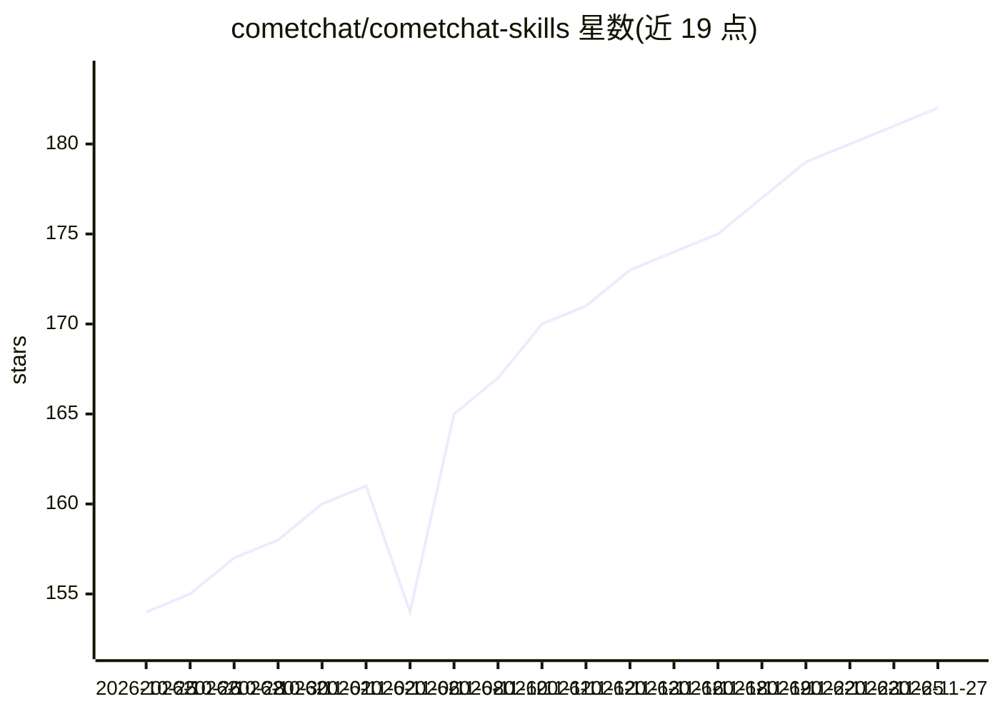

# cometchat/cometchat-skills

⭐ 182 · JavaScript · MIT · 推送 2026-11-13 · [GitHub](https://github.com/cometchat/cometchat-skills) · [官网](https://www.cometchat.com) · 组织维护

**让 AI 编码代理为应用接入 CometChat 聊天与通话的技能包**

以 npm 包发布的 agent 技能集：安装后用户对编码代理说一句需求，代理经 onboarding 流程（发现→理解→计划→确认）向六平台 UI Kit（React/Angular/React Native/iOS/Android/Flutter）及无头 Calls SDK 写入集成代码。技能通过 CometChat MCP 读取官方文档，未连接时回退网页抓取。附带从 Sendbird、Stream、Twilio 迁移的专用技能，含数据迁移脚本与移除清单。安装器自动检测项目类型并写入各代理的 MCP 配置。

## 筛选速览

| 维度 | 判定 | 备注 |
|---|---|---|
| AI 角色 | `ai-native` | 本体是模型或模型工具 |
| 许可风险 | `permissive` | MIT |
| 部署形态 | `library` | 以包/库形式分发 |
| 模型依赖 | — | README 未给出锁定关系 |
| 硬件要求 | — | 无带数字的原话,不猜 |
| 安装摩擦 | `low` | 无编译、无系统依赖或容器化 |
| 成熟度 | — | 结构信号不足 |

## 能力要点

- 覆盖 React/Angular/React Native/iOS/Android/Flutter 六平台 UI Kit 与无头 Calls SDK
- 安装器自动检测项目框架并写入对应代理的 MCP 配置
- 提供 Sendbird/Stream/Twilio 一句话迁移技能（分支操作、数据迁移脚本）
- 经 CometChat MCP 读取官方文档并以双门测试验证

## 适用场景

- 对编码代理说一句即在我的 React/Flutter 等应用中加入聊天与通话
- 把现有 Sendbird/Stream/Twilio 聊天应用迁移到 CometChat
- 通过代理为应用开启推送、webhook、深色模式等聊天功能

## 场景标签

`代码生成` · 领域:编码与开发

## 证据(README 行号)

> L3: **Add CometChat chat & calling to your app through your AI coding agent.** Install the skills, then ask your agent *
> L19: The installer **detects your project automatically** — React (Vite, Next.js, CRA, Astro, React Router), Angular, Re

## 星数曲线

2026-10-25 154 → 2026-11-27 182（+28）

---
*卡片 v1 · prompt 1.4 · 生成 2026-11-26 · 置信度 mid · 依据 README sha `541e0dc7ac51` · [字段定义](../../DATASET.md)*
