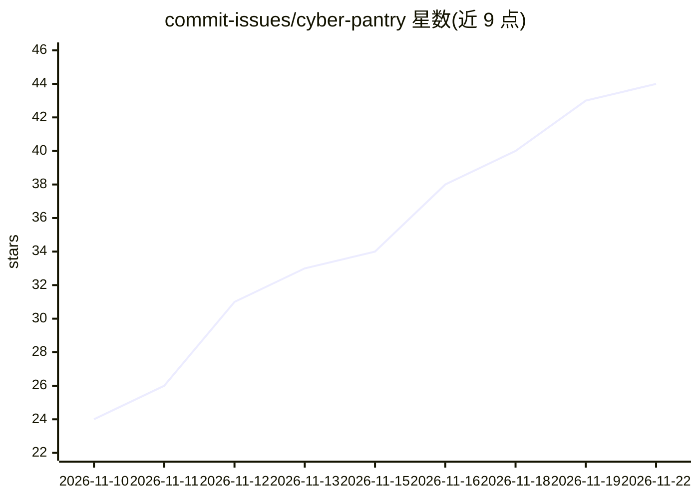

# commit-issues/cyber-pantry

⭐ 44 · HTML · NOASSERTION · 推送 2026-11-06 · [GitHub](https://github.com/commit-issues/cyber-pantry) · [官网](https://www.cyberpantry.org) · 个人维护

**325+ 条免费网络安全学习资源清单，按初学到进阶组织**

由 SudoChef 维护的网络安全资源聚合库，收录 325+ 条免费资源，按从初学者到进阶的路径分步组织，提供 cyberpantry.org 在线站点浏览。内容覆盖蓝队、漏洞赏金、云安全、恶意软件分析、认证、AI 安全等主题，并推介 Hack The Box Academy 作为合作方资源。仓库本身不提供工具或代码，许可限制为仅限个人使用，禁止未经书面许可的复制、修改与再分发。

## 筛选速览

| 维度 | 判定 | 备注 |
|---|---|---|
| AI 角色 | `ai-knowledge` | 知识聚合/清单类 |
| 许可风险 | `none` | NOASSERTION |
| 部署形态 | `None` |  |
| 模型依赖 | — | README 未给出锁定关系 |
| 硬件要求 | — | 无带数字的原话,不猜 |
| 安装摩擦 | `low` | 无编译、无系统依赖或容器化 |
| 成熟度 | — | 结构信号不足 |

## 能力要点

- 收录 325+ 条免费网络安全资源
- 按初学者到进阶的分步路径组织
- 提供 cyberpantry.org 在线浏览站点

## 适用场景

- 网络安全入门者按步骤寻找免费学习资源
- 蓝队、漏洞赏金、云安全等方向查找资料
- 备考安全认证时收集免费学习材料

## 场景标签

`精选清单` · 领域:学习与行业

## 证据(README 行号)

> L3: Cyber Pantry — a Cyber Resource library of 325+ free cybersecurity resources, by SudoChef. Laid out step by step, fr
> L5: 🌐 **Live site:** https://cyberpantry.org

## 星数曲线

2026-11-10 24 → 2026-11-22 44（+20）

---
*卡片 v1 · prompt 1.4 · 生成 2026-11-18 · 置信度 high · 依据 README sha `1d6bcaefb74e` · [字段定义](../../DATASET.md)*
