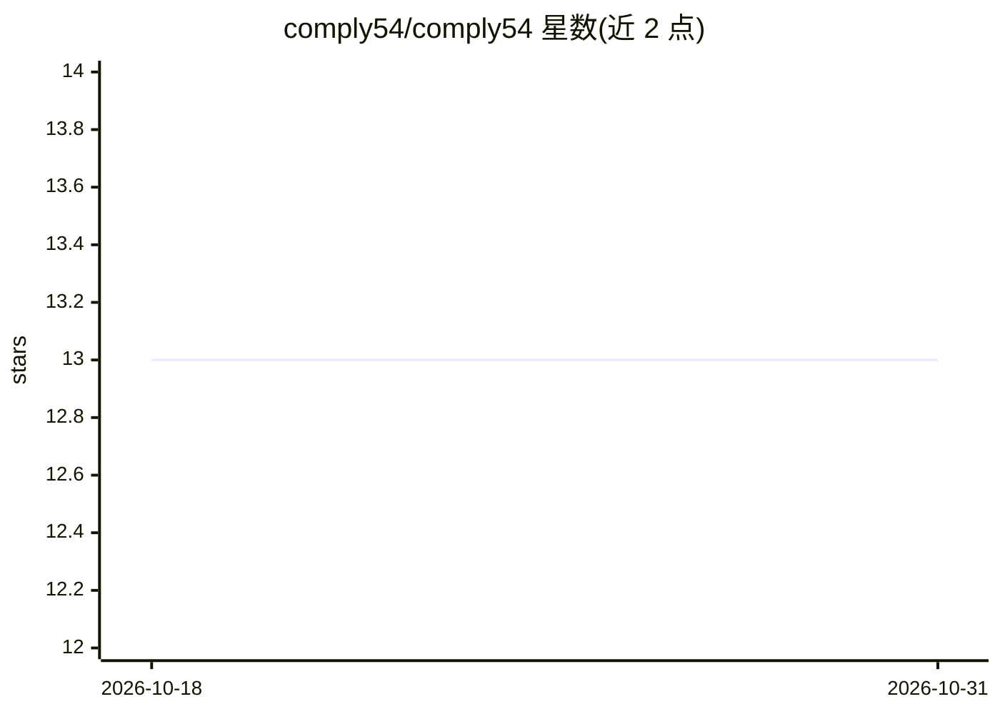

# comply54/comply54

⭐ 13 · Python · NOASSERTION · 推送 2026-10-25 · [GitHub](https://github.com/comply54/comply54) · [官网](https://comply54.io) · 个人维护

**面向非洲法规的 AI agent 工具调用运行时合规拦截库**

在 AI agent 执行工具调用前进行拦截并按非洲监管框架（NDPA、CBN、NHA、NAICOM、KDPA、POPIA 等 12+ 辖区）评估，违规调用返回错误、不触达工具。以 Python 库（pip 安装）提供，内置基于 regopy 的进程内 Rego 策略评估，无需 OPA 二进制；提供 LangGraph/LangChain/CrewAI/AutoGen 适配器、行业合规包（金融/医疗/保险）、防篡改合规证书与可离线验证的签名回执，附三个完整示例 agent 与 Colab 快速上手。限制：策略包为社区维护模板，非经认证的法律合规工具。

## 筛选速览

| 维度 | 判定 | 备注 |
|---|---|---|
| AI 角色 | `ai-ecosystem` | LLM/agent 周边工具 |
| 许可风险 | `none` | NOASSERTION |
| 部署形态 | `library` | 以包/库形式分发 |
| 模型依赖 | — | README 未给出锁定关系 |
| 硬件要求 | — | 无带数字的原话,不猜 |
| 安装摩擦 | `low` | 无编译、无系统依赖或容器化 |
| 成熟度 | — | 结构信号不足 |

## 能力要点

- 工具调用执行前的拦截式合规评估（blocked 调用不触达工具）
- 进程内 Rego 评估（regopy），无需 OPA 二进制，兼容 serverless
- LangGraph/LangChain/CrewAI/AutoGen 四类框架适配器
- SHA-256 防篡改合规证书与可离线验证的密码学签名回执

## 适用场景

- 给尼日利亚金融/医疗/保险 agent 加装 CBN/NDPA/NAICOM 合规护栏
- 多非洲市场 agent 用 PanAfricanFintechCompliance 统一覆盖多辖区法规
- 为审计方生成合规证书与签名回执

## 场景标签

`Agent 框架` · 领域:Agent 开发

## 证据(README 行号)

> L19: Comply54 intercepts AI agent tool calls and evaluates them against African regulatory frameworks — CBN, NDPA, NHA, 
> L45: framework adapters, and CI tooling that make those policies consumable from LangChain,

## 星数曲线

2026-10-18 13 → 2026-10-31 13（+0）

---
*卡片 v1 · prompt 1.4 · 生成 2026-10-31 · 置信度 high · 依据 README sha `20a5a42af0dc` · [字段定义](../../DATASET.md)*
