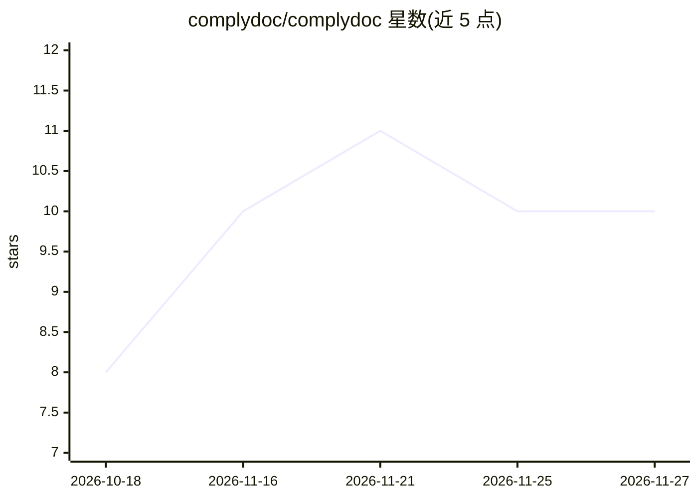

# complydoc/complydoc

⭐ 10 · Python · MIT · 推送 2026-11-25 · [GitHub](https://github.com/complydoc/complydoc) · [官网](complydoc.io) · 组织维护

**RAG 文档摄取的审计工具：比较 loader、追踪步骤与识别泄漏**

面向构建文档摄取管道的工程师：对比各 loader 对同一页面的读取差异，追踪每一步（loader/splitter/embedding/向量库）的时间、token、成本与传递的标识符，在嵌入前标记隐藏文本与个人财务标识符并掩码。提供 UI 查看、Python observe API、MCP 服务器（供 Claude/Cursor 等打开脱敏文档）及 CI 中的 check 检查，附 finance/legal/hr 预置策略。所有运行在本机完成，可阻断外联。

## 筛选速览

| 维度 | 判定 | 备注 |
|---|---|---|
| AI 角色 | `ai-ecosystem` | LLM/agent 周边工具 |
| 许可风险 | `permissive` | MIT |
| 部署形态 | `desktop` | 安装包/桌面程序 |
| 模型依赖 | — | README 未给出锁定关系 |
| 硬件要求 | — | 无带数字的原话,不猜 |
| 安装摩擦 | `low` | 无编译、无系统依赖或容器化 |
| 成熟度 | — | 结构信号不足 |

## 能力要点

- loader diff 与逐步 trace，含时间、token、成本与标识符传递记录
- 嵌入前检测隐藏文本与 checksum 校验的个人/财务标识符并掩码
- MCP 服务器模式与 Claude Code 插件安装
- CI GitHub Action 检查与预置 finance/legal/hr 策略

## 适用场景

- 上线前审查 RAG 管道各 loader 实际抽取的内容
- 防止 PDF 隐藏指令与黑条下的 IBAN 进入向量库
- 在 CI 中对文档目录执行合规策略检查

## 场景标签

`RAG` `文档解析` · 领域:知识与检索

## 证据(README 行号)

> L15: through. complydoc shows what your loaders actually extracted, flags hidden text and
> L19: Works with LangChain, LlamaIndex, Unstructured, Haystack, Docling, LlamaParse, Azure
> L76: - uses: complydoc/complydoc@v0.8.1

## 星数曲线

2026-10-18 8 → 2026-11-27 10（+2）

---
*卡片 v1 · prompt 1.4 · 生成 2026-11-19 · 置信度 high · 依据 README sha `2f0102a59252` · [字段定义](../../DATASET.md)*
