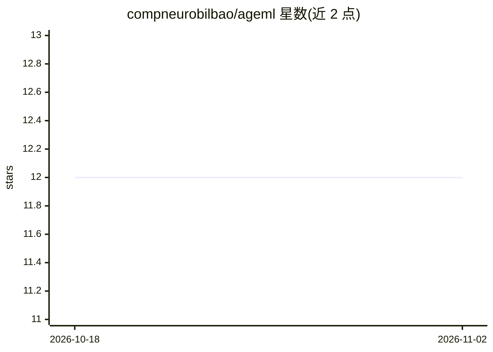

# compneurobilbao/ageml

⭐ 12 · Python · Apache-2.0 · 推送 2026-04-24 · [GitHub](https://github.com/compneurobilbao/ageml) · 组织维护

**用机器学习做年龄建模（脑龄等）的 Python CLI 工具包**

Python 包 ageml，通过一组命令行界面（CLI）完成年龄建模：从特征训练模型预测实际年龄，输出预测年龄、年龄差值（delta）、相关性分析与分布图；并支持临床分组间的差值比较、因子相关分析与临床二分类（含 ROC 曲线）。附带特征选择影响分析与 delta 用于逻辑回归的对比 CLI。面向研究人员的科研工具，提供 pip 安装、Docker 镜像与 Colab 入门 notebook，安装时无 GPU/系统级依赖要求。

## 筛选速览

| 维度 | 判定 | 备注 |
|---|---|---|
| AI 角色 | `ai-native` | 本体是模型或模型工具 |
| 许可风险 | `permissive` | Apache-2.0 |
| 部署形态 | `self-host` | docker 或自建部署 |
| 模型依赖 | — | README 未给出锁定关系 |
| 硬件要求 | — | 无带数字的原话,不猜 |
| 安装摩擦 | `low` | 无编译、无系统依赖或容器化 |
| 成熟度 | — | 结构信号不足 |

## 能力要点

- 4 个主 CLI：model_age / factor_correlation / clinical_groups / clinical_classify
- 训练年龄预测模型并输出年龄 delta、相关分析与分布图
- 临床分组比较与二分类（含 ROC 曲线）
- 提供 Colab notebook、Dockerfile 与 uv 开发流程

## 适用场景

- 从特征数据训练脑龄/年龄预测模型并计算年龄差值
- 分析临床组间年龄 delta 差异及与因子的相关性
- 利用年龄 delta 做临床组二分类并输出 ROC 曲线

## 场景标签

`科研工具` · 领域:学习与行业

## 证据(README 行号)

> L3: `ageml` is a Python package for Age Modelling with Machine Learning made easy.
> L14: - __model_age__: Trains a model to predict chronological age from features, with optional categorical and system-ba
> L17: - __clinical_classify__: Performs classification between two clinical groups using features and age deltas, outputt

## 星数曲线

2026-10-18 12 → 2026-11-02 12（+0）

---
*卡片 v1 · prompt 1.4 · 生成 2026-11-01 · 置信度 high · 依据 README sha `bcbf9c9d53cf` · [字段定义](../../DATASET.md)*
