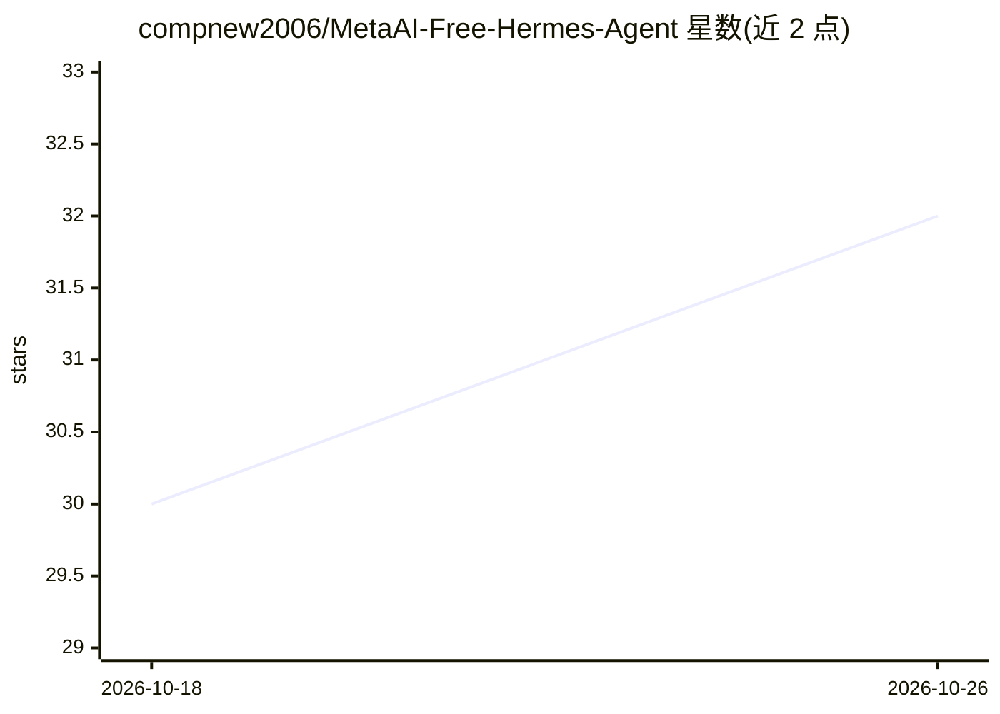

# compnew2006/MetaAI-Free-Hermes-Agent

⭐ 32 · TypeScript · NOASSERTION · 推送 2026-06-24 · [GitHub](https://github.com/compnew2006/MetaAI-Free-Hermes-Agent) · [官网](https://github.com/compnew2006/SMART_Studio_meta.ai_free) · 个人维护

**自托管 Go 代理：把 Meta AI 包装为 OpenAI 兼容端点供 Hermes Agent 调用**

由两部分组成：React 19 前端 SMART Studio（提供聊天、图像/视频生成、品牌与营销等 11 个工作室）与 Go 后端 metaai-go，后者通过浏览器 Cookie 认证直接与 meta.ai 交互，将 Muse Spark 模型包装成 OpenAI 兼容的 /v1/chat/completions 代理端点。用户将其接入 Hermes Agent，即可在 Telegram、WhatsApp、Discord 等平台调用 Meta AI，无需 API key。需要 VPS 或本地服务器，Cookie 会过期需手动更新；README 声明仅供教育用途、非官方集成。语音合成工作室需 Gemini API key。

## 筛选速览

| 维度 | 判定 | 备注 |
|---|---|---|
| AI 角色 | `ai-ecosystem` | LLM/agent 周边工具 |
| 许可风险 | `none` | NOASSERTION |
| 部署形态 | `desktop` | 安装包/桌面程序 |
| 模型依赖 | — | README 未给出锁定关系 |
| 硬件要求 | — | 无带数字的原话,不猜 |
| 安装摩擦 | `medium` | 含编译或系统依赖之一 |
| 成熟度 | — | 结构信号不足 |

## 能力要点

- Go 后端通过 Cookie 认证访问 Meta AI，暴露 OpenAI 兼容 /v1/chat/completions 端点
- REST API 覆盖聊天、图像生成、图像分析、异步视频生成等端点
- React 19 SMART Studio 前端，含聊天、创作、视频、品牌等工作室
- 支持 systemd 服务部署与单二进制生产构建

## 适用场景

- 在 Telegram/WhatsApp 上通过 Hermes Agent 免 API key 调用 Meta AI 模型
- 自建 OpenAI 兼容代理统一提供 Meta AI 聊天与图像生成
- 使用 Web 工作室生成营销内容、图像与视频

## 场景标签

`模型网关` `聊天机器人` `图像生成` `视频生成` · 领域:Agent 开发

## 证据(README 行号)

> L15: > 💡 **What is this?** A self-hosted Go API that wraps Meta AI (powered by Muse Spark) into an OpenAI-compatible end
> L75: Hermes Agent talks to `metaai-go` using the **OpenAI-compatible proxy** (`/v1/chat/completions`). This means Hermes

## 星数曲线

2026-10-18 30 → 2026-10-26 32（+2）

---
*卡片 v1 · prompt 1.4 · 生成 2026-10-26 · 置信度 high · 依据 README sha `0b79dfdf5286` · [字段定义](../../DATASET.md)*
