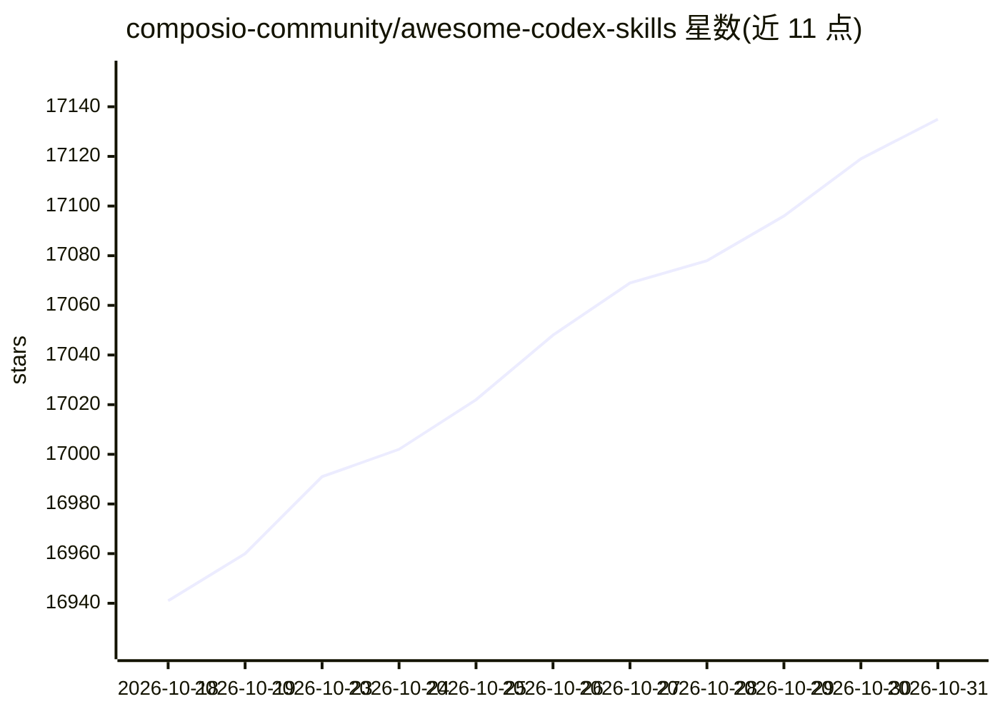

# composio-community/awesome-codex-skills

⭐ 17,135 · Python · 推送 2026-07-26 · [GitHub](https://github.com/composio-community/awesome-codex-skills) · 组织维护

**为 Codex CLI/API 用户提供自动化工作流技能的策展清单**

由 Composio 维护的 Codex 技能清单，按开发工具、效率协作、写作、数据分析、元工具等类别收录数十个 SKILL.md 格式的技能条目，覆盖代码审查、迁移审计、会议纪要、发票整理、幻灯片生成等场景。提供 Python 技能安装脚本与手动复制两种安装方式，技能放入 $CODEX_HOME/skills 目录后由 Codex 按 description 触发；同时包含技能创建模板与最佳实践说明。

## 筛选速览

| 维度 | 判定 | 备注 |
|---|---|---|
| AI 角色 | `ai-ecosystem` | LLM/agent 周边工具 |
| 许可风险 | `none` | — |
| 部署形态 | `library` | 以包/库形式分发 |
| 模型依赖 | — | README 未给出锁定关系 |
| 硬件要求 | — | 无带数字的原话,不猜 |
| 安装摩擦 | `low` | 无编译、无系统依赖或容器化 |
| 成熟度 | — | 结构信号不足 |

## 动量与使用信号

- 维护:`active` — 距上次 push 84.3 天,年发版 0,17 位贡献者
- 涨星:近 1 天 **+27**(自 20261016 起算)
- 安装:npm 包 `@smorky85/aurakit` 月下载 202
- 平台:— · 协议:MCP

## 能力要点

- 分类收录数十个 Codex 技能（SKILL.md 格式）
- 提供 skill-installer Python 脚本从 GitHub 安装技能
- 含 SKILL.md 模板与渐进式披露的技能创建指南
- 配套 Composio MCP Gateway 提供 1,000+ 集成的接入入口

## 适用场景

- 给 Codex CLI 查找并安装工作流自动化技能
- 按模板编写自己的 Codex 技能
- 用技能自动生成会议纪要、发票整理、PR 审查等产出

## 场景标签

`精选清单` `提示工程` · 领域:Agent 开发

## 证据(README 行号)

> L25: A curated list of practical Codex skills for automating workflows across the Codex CLI and API.
> L56: Codex skills are modular instruction bundles that tell Codex how to execute a task the way you want it done. Each s

## 星数曲线

2026-10-18 16,941 → 2026-10-31 17,135（+194）

---
*卡片 v1 · prompt 1.4 · 生成 2026-10-18 · 置信度 mid · 依据 README sha `4a916845a092` · [字段定义](../../DATASET.md)*
