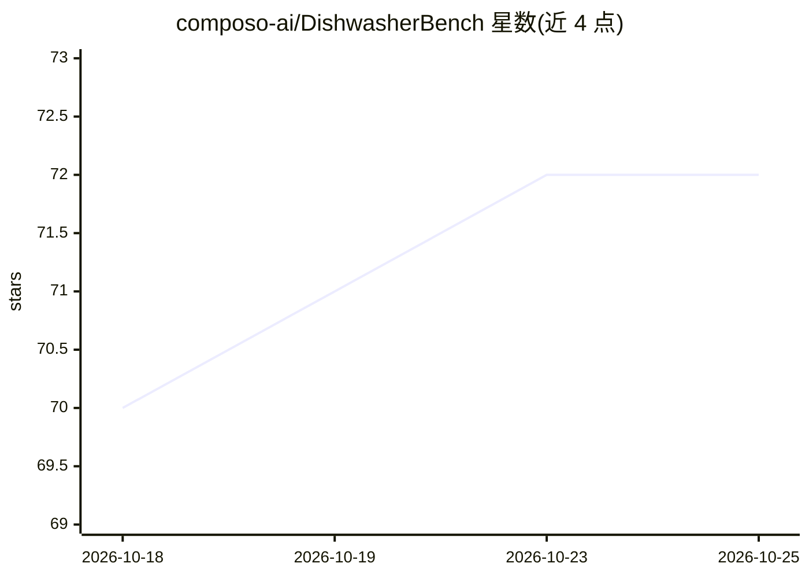

# composo-ai/DishwasherBench

⭐ 72 · TypeScript · MIT · 推送 2026-10-17 · [GitHub](https://github.com/composo-ai/DishwasherBench) · [官网](https://composo.ai) · 组织维护

**洗碗机装载游戏基准：物理仿真中评测语言模型**

在真实 Bosch 洗碗机（SMV4HAX40G）的刚体物理仿真上构建的洗碗机装载游戏 Spotless：玩家或模型把餐具装入碗架，随后模拟 Eco 50 洗涤程序（喷淋、水滴、洗涤剂化学），按洗净的物品计分。人类在浏览器中游玩，模型通过 OpenAI 兼容端点、Anthropic API 或 MCP（13 个工具）参与，同一网格同一动作。提供七个难度递增关卡、三个脚本参考玩家、46 项装载现象检查与校准工具。限制：在 macOS（Apple M3 Pro）开发测试，Linux/Windows 未测试；需 Node 20.19+、pnpm 9、可被 Dawn 打开的 GPU 与 Chrome。

## 筛选速览

| 维度 | 判定 | 备注 |
|---|---|---|
| AI 角色 | `ai-ecosystem` | LLM/agent 周边工具 |
| 许可风险 | `permissive` | MIT |
| 部署形态 | `library` | 以包/库形式分发 |
| 模型依赖 | — | README 未给出锁定关系 |
| 硬件要求 | — | 无带数字的原话,不猜 |
| 安装摩擦 | `low` | 无编译、无系统依赖或容器化 |
| 成熟度 | — | 结构信号不足 |

## 能力要点

- 基于真实洗碗机测量数据的刚体物理与洗涤仿真（官方档/快速档）
- 浏览器人玩、MCP/模型同场竞技，episode 可重放复验
- OpenAI 兼容端点与 Anthropic API 两种接入方式，记录 token 与成本
- 46 项文献装载现象检查与对标真实洗涤记录的校准工具

## 适用场景

- 评测语言模型在物理装载与空间推理任务上的表现
- 用 MCP 客户端 agent 接入游戏进行基准测试
- 人类游玩并与模型成绩对比（62 件物品的最大关卡）

## 场景标签

`模型评测` · 领域:评测与运维

## 证据(README 行号)

> L6: DishwasherBench is a dishwasher-loading game on a physical simulation of a real machine, built
> L19: - **One game for people and models.** People play in a browser and models play through MCP,
> L46: - **Three ways to play.** The page (`apps/web`), an MCP server for agents (`packages/mcp`), and a

## 星数曲线

2026-10-18 70 → 2026-10-25 72（+2）

---
*卡片 v1 · prompt 1.4 · 生成 2026-10-24 · 置信度 mid · 依据 README sha `86f7a0c6bacd` · [字段定义](../../DATASET.md)*
