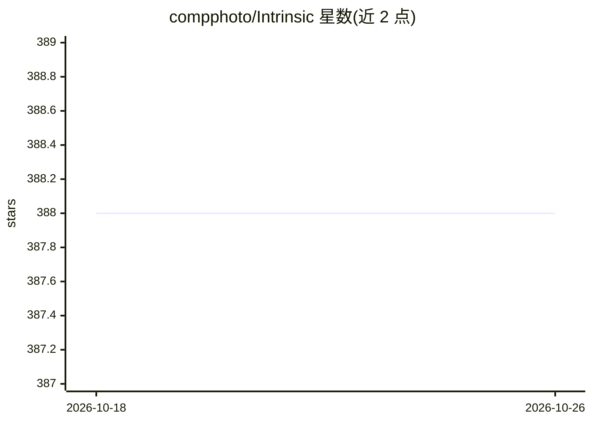

# compphoto/Intrinsic

⭐ 388 · Python · NOASSERTION · 推送 2026-04-03 · [GitHub](https://github.com/compphoto/Intrinsic) · [官网](https://yaksoy.github.io/intrinsic) · 组织维护

**野外图像高分辨率彩色本征图像分解的论文官方代码**

包含 TOG 2023《Intrinsic Image Decomposition via Ordinal Shading》与 TOG 2024《Colorful Diffuse Intrinsic Image Decomposition in the Wild》两篇论文的代码。方法分多阶段：先用 ordinal shading 流水线估计灰度明暗层，再估计低分辨率色度以处理彩色光照，最终输出高分辨率稀疏 albedo 分解，并可仅用单一合成室内数据集训练漫反射明暗估计网络。以 Python 包形式安装，提供 decompose 脚本、Colab 与 Hugging Face Spaces 在线演示，输出字典含白平衡图、镜面残差等多个本征分量。许可证为仅供学术使用，且标注专利申请中。

## 筛选速览

| 维度 | 判定 | 备注 |
|---|---|---|
| AI 角色 | `ai-native` | 本体是模型或模型工具 |
| 许可风险 | `none` | NOASSERTION |
| 部署形态 | `library` | 以包/库形式分发 |
| 模型依赖 | — | README 未给出锁定关系 |
| 硬件要求 | — | 无带数字的原话,不猜 |
| 安装摩擦 | `low` | 无编译、无系统依赖或容器化 |
| 成熟度 | — | 结构信号不足 |

## 能力要点

- 多阶段流水线输出高分辨率彩色本征分解（shading/albedo/chroma）
- 仅需单一渲染室内数据集即可训练漫反射明暗估计网络
- 支持逐像素白平衡、镜面去除等光照感知编辑操作
- 提供 Colab 与 Hugging Face Spaces 在线演示

## 适用场景

- 对自然图像做本征分解提取 albedo 与明暗层
- 基于分解结果做白平衡、去镜面等图像编辑
- 复现论文方法或在其基础上做逆渲染研究

## 场景标签

`图像视频处理` · 领域:感知与多模态

## 证据(README 行号)

> L5: **Colorful Diffuse Intrinsic Image Decomposition in the Wild**, Chris Careaga and Yağız Aksoy, ACM Transactions on G
> L13: We propose a method for generating high-resolution intrinsic image decompositions for in-the-wild images. Our metho
> L43: To run our pipeline on your own images you can use the decompose script:

## 星数曲线

2026-10-18 388 → 2026-10-26 388（+0）

---
*卡片 v1 · prompt 1.4 · 生成 2026-10-21 · 置信度 high · 依据 README sha `ec0aab060a77` · [字段定义](../../DATASET.md)*
