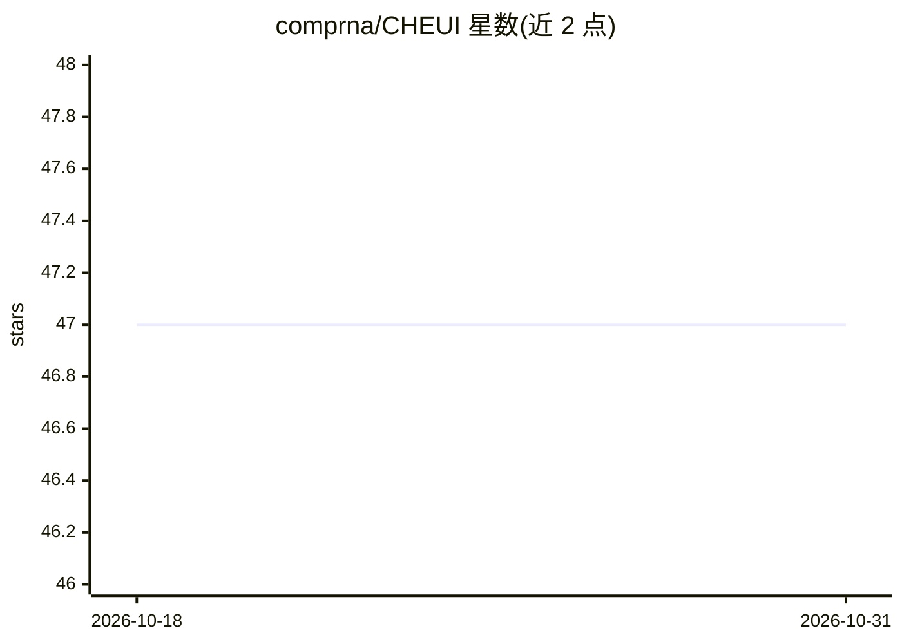

# comprna/CHEUI

⭐ 47 · C++ · NOASSERTION · 推送 2026-06-07 · [GitHub](https://github.com/comprna/CHEUI) · 组织维护

**从纳米孔直接 RNA 测序数据检测单分子 m6A/m5C 修饰的深度学习软件**

面向牛津纳米孔直接 RNA 测序数据的 RNA 修饰检测工具：用两阶段深度学习模型，在单读长和单核苷酸分辨率上同时检测 m6A 与 m5C，无需序列上下文约束；CHEUI-solo 检测单一条件下的修饰，CHEUI-diff 比较两个条件间的差异甲基化。运行前需经 Guppy basecalling、minimap2 比对与 Nanopolish eventalign 预处理信号，再经预处理脚本与模型 1/2 两步预测，输出读长级概率与位点级化学计量比。作者团队已发布 SWARM 作为后续工具。采用 Academic Public License，通过源码或 Conda 环境安装，依赖 Python 3.7 与 TensorFlow-GPU。

## 筛选速览

| 维度 | 判定 | 备注 |
|---|---|---|
| AI 角色 | `ai-native` | 本体是模型或模型工具 |
| 许可风险 | `none` | NOASSERTION |
| 部署形态 | `None` |  |
| 模型依赖 | — | README 未给出锁定关系 |
| 硬件要求 | — | 无带数字的原话,不猜 |
| 安装摩擦 | `medium` | 含编译或系统依赖之一 |
| 成熟度 | — | 结构信号不足 |

## 能力要点

- 两阶段深度学习模型同时检测 m6A 与 m5C
- 单读长、单核苷酸分辨率，无序列上下文约束
- 支持单条件修饰检测（CHEUI-solo）与两条件差异修饰检测（CHEUI-diff）
- 提供 C++ 版预处理脚本（快于 Python 版）

## 适用场景

- 对纳米孔直接 RNA 测序数据做转录组范围的 m6A/m5C 定位
- 在单个 reads 中估计甲基化概率
- 比较两个实验条件间的差异 RNA 甲基化

## 场景标签

 · 领域:生物信息学/表观转录组学

## 证据(README 行号)

> L5: CHEUI (Methylation (CH 3 ) Estimation Using Ionic current) is an RNA modification detection software for Oxford Nano
> L28: 1. Raw signal data (fast5) should be basecalled using Guppy 4.0.11+ (4.0.11 or later) (https://community.nanoporete

## 星数曲线

2026-10-18 47 → 2026-10-31 47（+0）

---
*卡片 v1 · prompt 1.4 · 生成 2026-10-25 · 置信度 high · 依据 README sha `40b96a13f5d8` · [字段定义](../../DATASET.md)*
