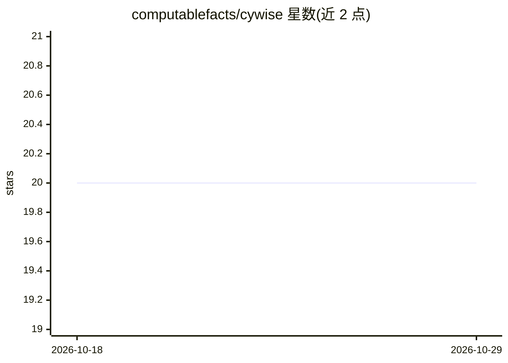

# computablefacts/cywise

⭐ 20 · PHP · AGPL-3.0 · 推送 2026-10-28 · [GitHub](https://github.com/computablefacts/cywise) · [官网](https://cywise.io) · 组织维护

**面向中小企业/团队的自托管开源网络安全平台（漏洞扫描、加固、AI 助手）**

Cywise 的自托管开源版本，为中小企业提供漏洞扫描（5 万+漏洞库）、Linux/Windows 服务器加固与实时可疑活动检测（基于 OSSEC 规则与 Osquery 事件采集）、系统指标采集，以及可接入内部文档库的 SSO。AI 部分包括 CyberBuddy 自然语言编排助手（规划工具调用、RAG 知识库、JSON-RPC 控制 Cywise 功能与第三方系统）与 SOC Operator 事件分析 agent（输出 NORMAL/SUSPECT/ABNORMAL 判定与置信度）。自托管版的 AI 功能需自备 DeepInfra API key；数据泄露监测与蜜罐功能仅限 SaaS 版。安装方式为 Linux + Docker + git clone 仓库运行。

## 筛选速览

| 维度 | 判定 | 备注 |
|---|---|---|
| AI 角色 | `ai-enhanced` | 去掉 AI 部分产品仍成立 |
| 许可风险 | `viral` | AGPL-3.0 |
| 部署形态 | `self-host` | docker 或自建部署 |
| 模型依赖 | — | README 未给出锁定关系 |
| 硬件要求 | — | 无带数字的原话,不猜 |
| 安装摩擦 | `low` | 无编译、无系统依赖或容器化 |
| 成熟度 | — | 结构信号不足 |

## 能力要点

- 漏洞扫描：持续监测 5 万+ 漏洞并给出分级修复建议与修复确认
- CyberBuddy 自然语言编排：RAG 知识库 + JSON-RPC 调用平台与第三方（Jira、AWS 等）功能
- SOC Operator 自主分析安全事件，输出判定/置信度/处置建议
- 服务器加固与可疑行为检测基于 OSSEC 规则和 Osquery 采集

## 适用场景

- 扫描并修复暴露在互联网上的网站与基础设施漏洞
- 加固内网 Linux/Windows 服务器并实时检测异常行为
- 通过 Telegram/WhatsApp 用自然语言操作安全平台
- 让 AI 按内部规程自主分析安全事件并给出处置建议

## 场景标签

`网络安全` · 领域:学习与行业

## 证据(README 行号)

> L152: CyberBuddy est au coeur de l'expérience Cywise. Il agit comme un orchestrateur intelligent capable de comprendre v
> L191: L'Opérateur SOC est un agent spécialisé dans l'analyse d'événements de sécurité. Il agit comme un analyste de nive
> L121: > Pour activer cette fonctionnalité dans la version auto-hébergée, vous devrez fournir votre propre clé d'API Deep

## 星数曲线

2026-10-18 20 → 2026-10-29 20（+0）

---
*卡片 v1 · prompt 1.4 · 生成 2026-10-28 · 置信度 high · 依据 README sha `305070b05303` · [字段定义](../../DATASET.md)*
