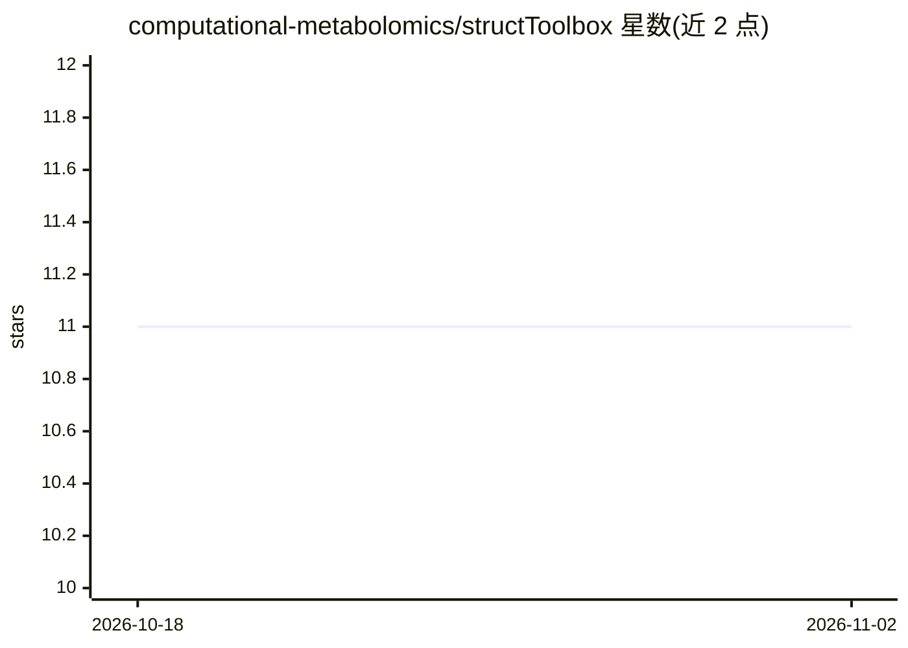

# computational-metabolomics/structToolbox

⭐ 11 · R · GPL-3.0 · 推送 2026-04-16 · [GitHub](https://github.com/computational-metabolomics/structToolbox) · [官网](https://computational-metabolomics.github.io/structToolbox/) · 组织维护

**代谢组学等组学数据的统计与机器学习分析 R/Bioconductor 工具箱**

R/Bioconductor 包，基于 struct 包的类模板为代谢组学及其他组学数据提供预处理（信号漂移与批次校正、归一化、缺失值插补、缩放）、单变量检验（t 检验、多种 ANOVA、Kruskal–Wallis 等）、多变量方法（PCA、PLS，含交叉验证与置换检验）及机器学习方法（如支持向量机）。用户可借此构建标准化数据分析工作流，STATO 本体被集成以提供方法、输入输出的标准化定义。通过 BiocManager 安装，开发版可经 remotes 从 GitHub 安装。

## 筛选速览

| 维度 | 判定 | 备注 |
|---|---|---|
| AI 角色 | `ai-native` | 本体是模型或模型工具 |
| 许可风险 | `viral` | GPL-3.0 |
| 部署形态 | `None` |  |
| 模型依赖 | — | README 未给出锁定关系 |
| 硬件要求 | — | 无带数字的原话,不猜 |
| 安装摩擦 | `low` | 无编译、无系统依赖或容器化 |
| 成熟度 | — | 结构信号不足 |

## 能力要点

- 覆盖预处理、单变量、多变量与机器学习方法的组学分析工具集
- 基于 struct 类模板构建标准化可组合的数据分析工作流
- 集成 STATO 本体提供方法与输入输出的标准化定义
- 含交叉验证与置换检验等统计验证手段

## 适用场景

- 对 LC-MS/DIMS 代谢组学数据做批次校正与归一化等预处理
- 构建标准化的组学统计分析工作流（PCA、PLS、ANOVA 等）
- 对组学数据应用 SVM 等机器学习方法并做交叉验证

## 场景标签

`数据分析` · 领域:效率与自动化

## 证据(README 行号)

> L3: An extensive set of data (pre-)processing and analysis methods and
> L15: PLS, including cross-validation and permutation testing) as well as machine
> L16: learning methods (e.g. Support Vector Machines). The

## 星数曲线

2026-10-18 11 → 2026-11-02 11（+0）

---
*卡片 v1 · prompt 1.4 · 生成 2026-11-02 · 置信度 high · 依据 README sha `11f98197e809` · [字段定义](../../DATASET.md)*
