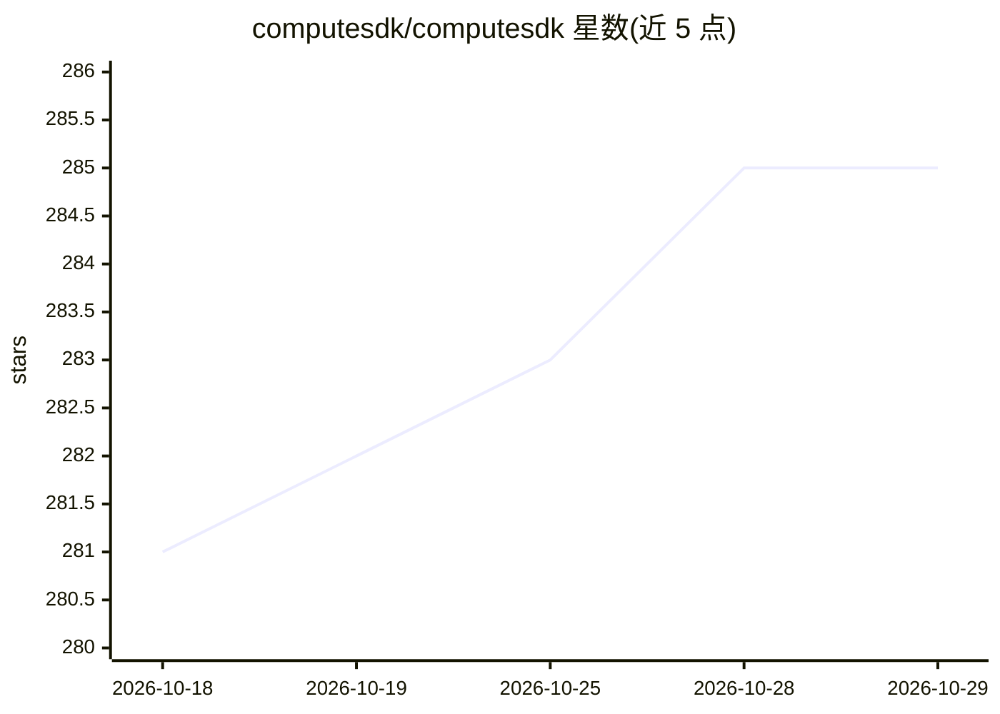

# computesdk/computesdk

⭐ 285 · TypeScript · MIT · 推送 2026-10-28 · [GitHub](https://github.com/computesdk/computesdk) · [官网](https://computesdk.com) · 组织维护

**给开发者的多云端沙箱统一 SDK 与基准评测工具**

TypeScript SDK，通过统一 API 在 40 余个云端沙箱提供商（E2B、Modal、Daytona、Vercel、AWS 等）上创建沙箱、执行命令、操作文件系统与交互终端，支持运行时切换提供商、多提供商配置与自定义 Provider 扩展。同时是 ComputeSDK Benchmarks 背后的开源基准评测引擎，可在各提供商上运行同一负载并发布可复现结果。面向构建 AI 代码执行 agent、数据科学平台与开发者工具的开发者，以 npm 包形式分发。

## 筛选速览

| 维度 | 判定 | 备注 |
|---|---|---|
| AI 角色 | `ai-ecosystem` | LLM/agent 周边工具 |
| 许可风险 | `permissive` | MIT |
| 部署形态 | `library` | 以包/库形式分发 |
| 模型依赖 | locked-api |  |
| 硬件要求 | — | 无带数字的原话,不猜 |
| 安装摩擦 | `low` | 无编译、无系统依赖或容器化 |
| 成熟度 | — | 结构信号不足 |

## 能力要点

- 40 余个沙箱提供商的统一 TypeScript API
- 运行时切换提供商，应用代码不变
- 可复现的跨提供商基准评测负载（ComputeSDK Benchmarks）
- 通过 @computesdk/provider 框架扩展自定义提供商

## 适用场景

- 让 AI agent 在云沙箱中执行代码，不被单一提供商绑定
- 在多个沙箱基础设施上运行同一负载做基准对比
- 构建需要远程代码执行的开发者工具或教学环境

## 场景标签

 · 领域:开发工具/云沙箱基础设施

## 证据(README 行号)

> L15: ComputeSDK is the open, multi-provider benchmark harness for cloud infrastructure. It is the engine behind ComputeS
> L20: - **Build provider-agnostic apps** — switch sandboxes without changing application code for AI agents, code-executi

## 星数曲线

2026-10-18 281 → 2026-10-29 285（+4）

---
*卡片 v1 · prompt 1.4 · 生成 2026-10-22 · 置信度 high · 依据 README sha `71509483af06` · [字段定义](../../DATASET.md)*
