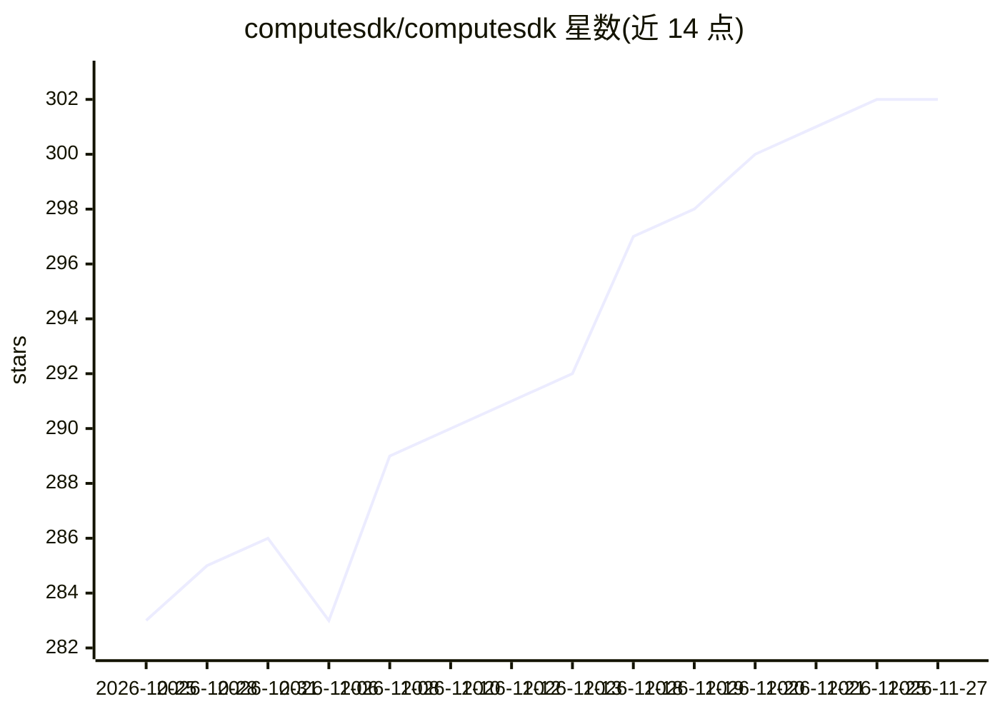

# computesdk/computesdk

⭐ 302 · TypeScript · MIT · 推送 2026-11-26 · [GitHub](https://github.com/computesdk/computesdk) · [官网](https://computesdk.com) · 组织维护

**为应用运行他人代码的沙箱路由工具包**

ComputeSDK 提供统一的沙箱路由器与 Actions 两类执行方式：前者通过 compute CLI、TypeScript SDK 或 API 在隔离沙箱中运行生成的代码、测试与脚本，支持自动选择 provider、手动指定或设置 fallback 顺序，可选择托管计算或自带 provider 密钥（BYOK）；后者在同一路由器上运行支持的 GitHub workflow，可跟踪日志、下载产物与重跑失败任务。提供 npm 安装的 CLI 与 SDK、macOS/Linux/Windows 安装器，并支持通过 MCP server 连接 AI 助手。创建沙箱需要可用额度或配置 BYOK 路由。

## 筛选速览

| 维度 | 判定 | 备注 |
|---|---|---|
| AI 角色 | `ai-ecosystem` | LLM/agent 周边工具 |
| 许可风险 | `permissive` | MIT |
| 部署形态 | `library` | 以包/库形式分发 |
| 模型依赖 | — | README 未给出锁定关系 |
| 硬件要求 | — | 无带数字的原话,不猜 |
| 安装摩擦 | `low` | 无编译、无系统依赖或容器化 |
| 成熟度 | — | 结构信号不足 |

## 能力要点

- 统一路由器在多 provider 沙箱中运行代码，支持 fallback 顺序
- 支持托管计算与 BYOK（自带 provider 密钥）两种模式
- compute CLI 提供 login/route/exec/destroy 等命令行管理
- 提供 MCP server 供 AI 助手连接

## 适用场景

- 在应用中安全运行 AI agent 生成的代码
- 在隔离沙箱中执行测试与脚本
- 通过统一路由器在沙箱 provider 上运行 GitHub workflow

## 场景标签

 · 领域:AI 基础设施/代码执行沙箱

## 证据(README 行号)

> L9:  Run agent code and GitHub workflows across sandbox providers. We handle the compute.
> L24: - **Sandbox Router** runs generated code, tests, and scripts in isolated sandboxes. Use the `compute` CLI, TypeScri

## 星数曲线

2026-10-25 283 → 2026-11-27 302（+19）

---
*卡片 v1 · prompt 1.4 · 生成 2026-11-25 · 置信度 high · 依据 README sha `19685b80e297` · [字段定义](../../DATASET.md)*
