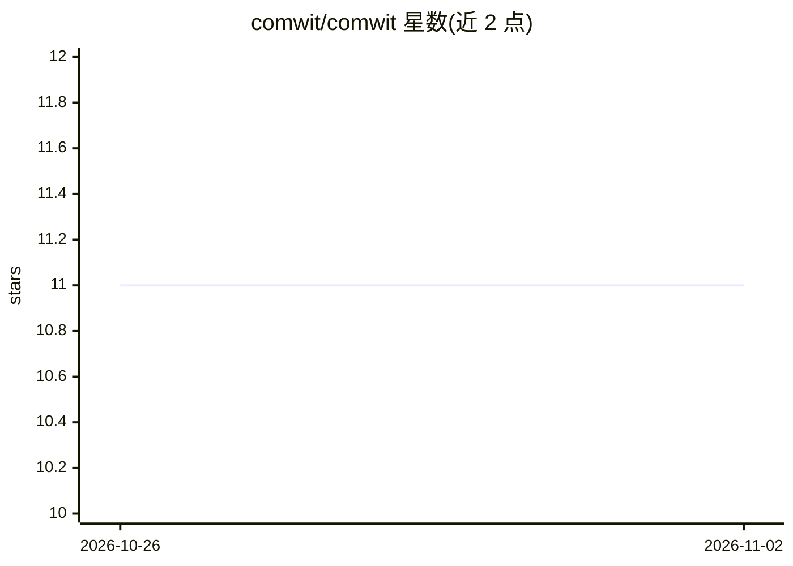

# comwit/comwit

⭐ 11 · MDX · MIT · 推送 2026-10-31 · [GitHub](https://github.com/comwit/comwit) · [官网](https://library.comwit.io) · 组织维护

**面向 AI 辅助开发的 React 状态管理与模板共享工作区**

由 State、UI 与 template 三个独立产品组成的 monorepo 工作区：@comwit/state 提供 React 状态管理包，UI 仓库含组件目录与 Storybook，template 仓库维护 base/shop/course 三个 Next.js 应用模板分支，各自的 skills 与 rules 随模板分发。仓库本身承担共享文档、示例与集成测试；通过 git submodule 组织各产品，各产品保持独立 lockfile、API 与独立 Star。面向参与该工作区开发的工程师，需按 submodule 流程提交 PR。

## 筛选速览

| 维度 | 判定 | 备注 |
|---|---|---|
| AI 角色 | `ai-ecosystem` | LLM/agent 周边工具 |
| 许可风险 | `permissive` | MIT |
| 部署形态 | `library` | 以包/库形式分发 |
| 模型依赖 | — | README 未给出锁定关系 |
| 硬件要求 | — | 无带数字的原话,不猜 |
| 安装摩擦 | `low` | 无编译、无系统依赖或容器化 |
| 成熟度 | — | 结构信号不足 |

## 能力要点

- State/UI/template 三产品以 git submodule 组织，API 与发布名独立
- template 分支 main/shop/course 分别对应基础、商店与课程平台应用
- create-comwit 打包各 pinned 源码树，--shop/--course 选择分支
- 提供 pnpm build/test/typecheck 与 template:validate 集成校验

## 适用场景

- 在统一工作区中开发 State、UI 与模板并做集成检查
- 通过 create-comwit 生成带 skills 与 rules 的 Next.js 项目
- 克隆 shop 分支获取含商店、支付与管理功能的电商模板

## 场景标签

 · 领域:Web 前端开发工具

## 证据(README 行号)

> L3: Comwit is the shared development workspace,
> L14: State and UI are independent products. Public npm package names and APIs stay the same.
> L18: setup and `PUBLIC_SOURCE.json` fingerprints. `create-comwit` packages every pinned

## 星数曲线

2026-10-26 11 → 2026-11-02 11（+0）

---
*卡片 v1 · prompt 1.4 · 生成 2026-11-02 · 置信度 low · 依据 README sha `a68cec5e1ec6` · [字段定义](../../DATASET.md)*
