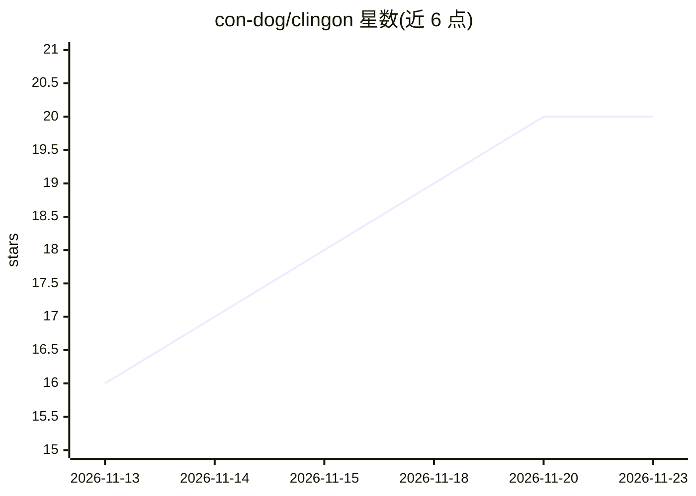

# con-dog/clingon

⭐ 20 · Go · MIT · 推送 2026-11-21 · [GitHub](https://github.com/con-dog/clingon) · [官网](https://github.com/con-dog/clingon) · 个人维护

**macOS 侧边命令菜单工具，AI 可代替用户挑选并执行命令**

运行于 macOS（zsh/bash）的终端侧边命令菜单工具：内置 20 个命令包（git、docker、aws、postgres 等），以 Markdown 文件组织命令，填空后在自己的真实 shell 中执行；支持按 1-9 将命令串成 recipe 顺序执行，危险命令有 No/Yes 或输入代码的确认机制。AI 功能需配置 OpenRouter key，给定任务后由 AI 操作菜单执行，任务、菜单与屏幕内容会发送至 OpenRouter 及模型提供方。通过 Homebrew 安装，也可用 Go 从源码构建。

## 筛选速览

| 维度 | 判定 | 备注 |
|---|---|---|
| AI 角色 | `ai-enhanced` | 去掉 AI 部分产品仍成立 |
| 许可风险 | `permissive` | MIT |
| 部署形态 | `None` |  |
| 模型依赖 | locked-api |  |
| 硬件要求 | — | 无带数字的原话,不猜 |
| 安装摩擦 | `low` | 无编译、无系统依赖或容器化 |
| 成熟度 | — | 结构信号不足 |

## 能力要点

- 命令以 Markdown 文件组织，既是文档又可在工具内运行
- AI 接收任务后通过菜单驱动命令执行（需 OpenRouter key）
- 危险命令分级确认：⚠ 需 Yes/No，☠ 需输入代码
- 命令可串成 recipe 顺序执行，失败即停

## 适用场景

- 不记命令时从菜单挑选并填空执行，替代搜索
- 让 AI 代为完成需要多个命令的任务
- 以 Markdown 维护团队命令包并在真实 shell 中执行

## 场景标签

`AI 助手` `工作流自动化` · 领域:效率与自动化

## 证据(README 行号)

> L14: - **An AI drives it for you.** Give it a task and watch it use the menu as you would.
> L15: - **It's your real shell.** Your config, aliases and environment. clingon only types the command in.

## 星数曲线

2026-11-13 16 → 2026-11-23 20（+4）

---
*卡片 v1 · prompt 1.4 · 生成 2026-11-18 · 置信度 high · 依据 README sha `87a1327ae798` · [字段定义](../../DATASET.md)*
