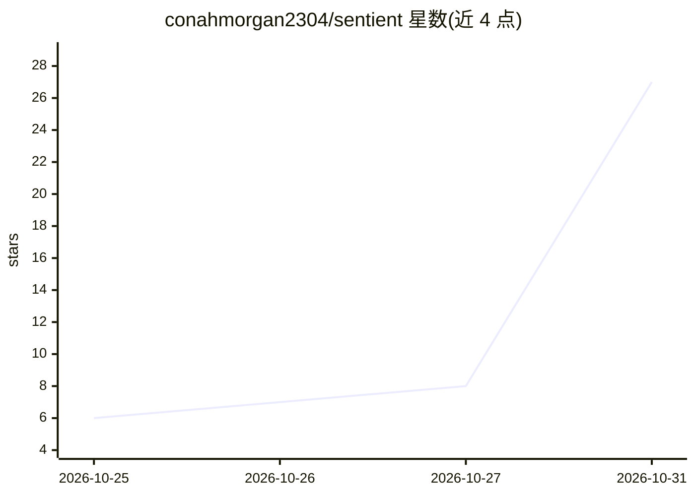

# conahmorgan2304/sentient

⭐ 27 · Python · MIT · 推送 2026-10-28 · [GitHub](https://github.com/conahmorgan2304/sentient) · 个人维护

**Home Assistant 的共享 AI 大脑：全屋记忆与统一语音规则**

作为 Home Assistant 自定义组件运行，让全屋各语音助手与自动化共用同一份长期记忆和统一的说话规则。本身不自带 API key，接入已有的会话代理（Google Gemini、OpenAI、Ollama 等）。功能包括共享记忆、安静时段与房间定位的播报规则、设备/摄像头监视、按统计学习灯与开关的日常规律、门口访客记录、简报、提醒与时间线日志；部分功能（如移动感应灯）不使用 AI。需 Home Assistant 2025.10 或更新版本，摄像头相关功能需 AI Task 实体。

## 筛选速览

| 维度 | 判定 | 备注 |
|---|---|---|
| AI 角色 | `ai-enhanced` | 去掉 AI 部分产品仍成立 |
| 许可风险 | `permissive` | MIT |
| 部署形态 | `None` |  |
| 模型依赖 | local-ok | 支持本地模型 |
| 硬件要求 | — | 无带数字的原话,不猜 |
| 安装摩擦 | `low` | 无编译、无系统依赖或容器化 |
| 成熟度 | `idea` | |

## 能力要点

- 全屋语音助手共享长期记忆，近期重复记忆自动合并
- 统一房屋说话规则：安静时段、按房间活动定位播报、去重与禁用词
- 设备与摄像头监视（sentient.watch），摄像头仅在自身传感器触发时调用 AI
- 按普通统计从两周历史学习灯光开关规律，无需 AI

## 适用场景

- 让家里多个语音助手共享同一份记忆和规则
- 让房屋按我的作息在合适的房间、合适的时间开口
- 用语音设置监视项：洗衣机结束、花园摄像头看猫等

## 场景标签

`Agent 记忆` `语音 Agent` · 领域:Agent 开发

## 证据(README 行号)

> L7: Sentient gives your home one shared brain. Every voice assistant and automation in the house uses the same memory, f
> L34: - **Motion lights.** Pick a light and its motion sensors on the Settings tab: it comes on with movement between sun

## 星数曲线

2026-10-25 6 → 2026-10-31 27（+21）

---
*卡片 v1 · prompt 1.4 · 生成 2026-10-30 · 置信度 mid · 依据 README sha `73713d612c14` · [字段定义](../../DATASET.md)*
